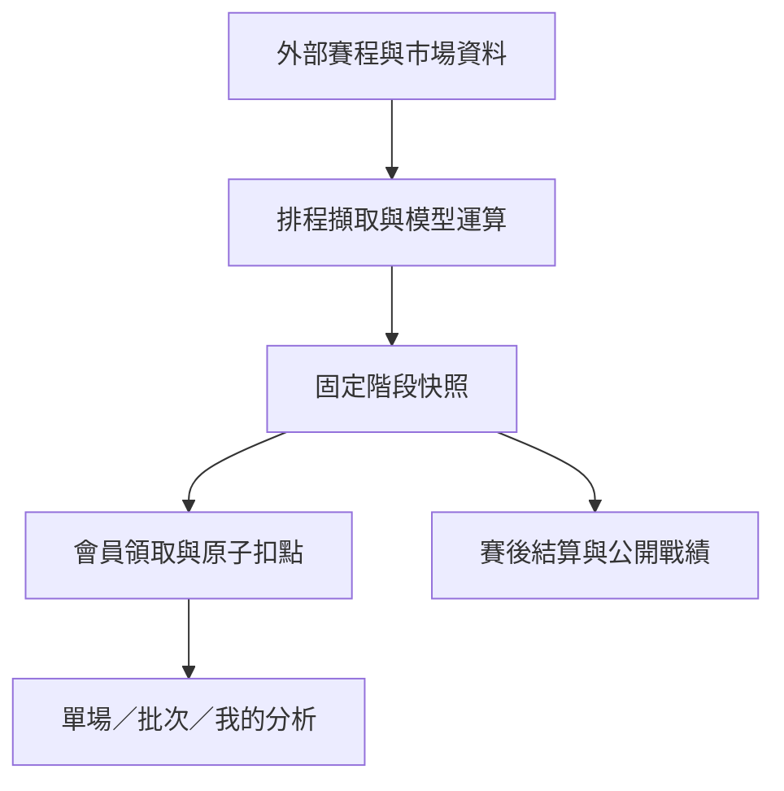

# PROJECT_NOTES — HABAO 哈寶體育 AI

> 交接基準：2026-11-15（Asia/Taipei）。讀者：後續維護工程師、其他 AI 助手、專案負責人 Andy。
> 這是現況說明與維護約束，不是授權執行部署、SQL 或付款的指令。本文未存放 API Key、JWT、管理員憑證或個人會員資料。

## 0. 接手先讀：證據、版本與操作權限

### 0.1 證據如何判讀

本文區分四種狀態：

- **程式碼確認**：已讀 GitHub／本地對應來源，可說明實作，但不代表 Supabase 正在執行同一版。
- **先前部署／實測確認**：本次對話或部署驗證檔曾記錄成功；只代表當時狀態。
- **本次確認**：交接整理時重新讀取 GitHub 的狀態。
- **待確認**：未取得當前後端資料、缺實場、欠回測或資料不足；不得自行補成「正常」。

重要區別：`Cron succeeded`、HTTP 200、`release_ready`、模板測試通過、預測準確率通過，是五件不同的事。排入 HTTP 佇列成功也不代表 Edge Function 已完成。

### 0.2 倉庫與部署

| 項目 | 位置／現況 |
|---|---|
| GitHub | `awu7757-sys/habao-football-ai` |
| 正式分支 | `main` |
| 前台 | GitHub Pages：`https://awu7757-sys.github.io/habao-football-ai/` |
| Supabase 專案 | 名稱「哈寶足球AI」；project ref：`oqtbsbohcfeghgnykwxy` |
| 本次讀到的 main HEAD | `2c26f99cea83f603ce542d08b5dfbe501df69c27` |
| 最近前台功能提交 | `0ad0c66b731ee4c84d3518c9ce7ac2da4481a0a2`：30D 戰績、首頁三球類統計 |
| 最近補充提交 | `2c26f99...`：唯讀排程檢查改成單一可匯出結果集 |
| 本次部署確認 | 上述 HEAD 的 `pages build and deployment` 已 `completed / success` |
| 文件本身 | 提供交接檔；本次未將此文件提交 GitHub |

**GitHub Pages 成功不等於 Supabase 已部署。** `supabase/functions/` 與 `deploy/` 有重複、歷史版及組合產物，不能任選一份覆蓋線上函式。請先比對最後部署紀錄、版本、原始碼雜湊與依賴。

### 0.3 使用者目前的授權

1. **Supabase 讀取與修改均已撤銷，連接已移除。** 不得改走 HTTP、SQL、CLI、瀏覽器或舊金鑰繞過。
2. **GitHub 可以直接讀取；每次修改須先取得使用者允許。** 本次五項前台改動已獲單次授權並完成，不能推論後續修改也獲授權。
3. 後端目前採「提供程式／SQL，由使用者自行執行」方式。
4. LINE 更換延後，尚未提供新網址；目前不得更換。
5. 使用者偏好：繁體中文、先說結論、操作要指出檔案、搜尋位置、替換起訖、保留區段與是否 Commit。

## 1. 專案目標與核心理念

HABAO 是供會員查看足球、NBA、MLB 賽前量化分析及公開驗證結果的網站／PWA。管理者能管理會員、積分、資料來源用量、正式快照與研究對照。

核心要解決的問題：

- 使用者無須自行彙整賽程、盤口、球隊近期表現、傷停與先發。
- 同一場同一階段的會員應看到同一份固定結果，不能因點擊時間、單場／批次入口不同而改變。
- 透過賽前封存與賽後驗證，避免事後改推薦、挑選好看的賽事或用完賽資料偽造賽前成績。
- API 呼叫集中在系統擷取／快取，會員優先讀快照，降低重複分析與成本。
- 缺資料要明確保留原因，不能把「沒有取得」當成「沒有傷停」，也不能製造盤口或信心值。

產品名稱中的 AI 不代表每場都呼叫 GPT／Claude。可見的主要路徑是程式化統計模型；LLM 影子程式存在，但先前決策為停用，不新增常態 LLM 成本。是否仍完全停用須以目前後端設定確認。

## 2. 系統架構

### 2.1 主流程



- 前台：靜態 HTML、CSS、原生 JavaScript，沒有確認為整站 SPA 框架。
- 登入與會員：Supabase Auth／OAuth 身分，搭配應用層會員資料與積分；舊帳號路徑仍有殘留。
- 後端：Supabase Edge Functions、Postgres、RPC、RLS、`pg_cron`、`pg_net`、Vault。
- 顯示時區：Asia/Taipei；儲存時間多為 UTC／timestamptz。NBA 官方來源另涉及美東日界及夏令時間。
- 靜態站版本由 GitHub Pages 更新；函式、Schema、排程、Secrets、會員開放設定各自獨立。

### 2.2 前台頁面與共用程式

| 檔案 | 職責 | 維護注意 |
|---|---|---|
| `index.html` | 登入／入口、Google／LINE OAuth、PWA handoff、客服 | LINE 登入與 LINE 客服不是同一件事 |
| `home-v2.html` | 目前新版會員首頁、三張統計卡、焦點賽事、工具入口、合作平台、客服浮鈕 | 最新統計已接三球類；焦點賽事區仍沿用既有足球內容 |
| `home.html` | 舊會員首頁 | 不要誤把舊頁當正式修改目標；所有導流是否已離開此頁待確認 |
| `football.html` | 名稱仍是 football，但實際為三球類賽事中心與「我的分析」主容器 | 今天／明天、球類切換、勾選批次、階段領取、歷史重看 |
| `analysis.html` | 足球／NBA 及共用結果呈現 | 單場、批次使用固定結果資料，不重新算模型 |
| `mlb-analysis.html` | MLB 結果入口 | 最近驗證與 `analysis.html` 同內容；後續不要分叉造成差異 |
| `performance.html` | 三球類公開戰績、命中走勢、驗證紀錄 | 最新預設 30D；驗證紀錄獨立固定近 30 天 |
| `mlb-performance.html` | MLB 戰績相關舊入口 | 和共用戰績頁的導航關係，重構前需核對 |
| `ai-tools.html` | AI 工具箱 | 由相關開關／入口設定控制 |
| `fund-plan-beta.html` | 資金計畫實驗頁 | 不應直接當作三階段核心功能 |
| `admin.html` | 管理中心，會員、API、功能開關、分析與公開戰績管理等 | 實際可用模組須依當前後端核對；存在其他 admin 外掛 JS |
| `admin-football-v2.js`、`admin-nba-v2.js`、`admin-baseball-v2.js`、`admin-nba-backtest.js` | 分球類研究／階段／回測管理畫面 | 研究資料與正式會員快照不可混用 |
| `sports-stage-core.js` | 階段、狀態、ID、歷史分組、推薦欄位等共用純邏輯 | 前台、驗證頁、測試共用；更改會跨球類影響 |
| `sports-stages.js`＋`sports-stages.css` | 正式三球類領取、單／批次、按鈕、歷史、顏色控制 | 會包裝舊頁面的函式；不能只改舊版 handler |
| `sports-analysis-contract.js` | 分析結果共用契約／顯示整合 | 保留球類、場次、階段識別及欄位語意 |
| `home-sports-stats.js` | 2026-11-15 新增首頁三球類唯讀彙總 | 不得在統計時呼叫 claim／capture／扣點 |
| `mlb-match-center.js` | MLB 賽程、球隊顯示、賽事中心適配 | 存在 legacy 開關與新版 controller 整合 |
| `nba-stages.js` | NBA 舊階段控制相容程式 | 不要與共用 controller 同時重複扣點／觸發分析 |
| `habao-i18n.js`、`opencc.js` | 繁中／簡中／英文、轉換 | 新文字需考慮三語；不能把 API 欄位名一起翻譯 |
| `habao-loading.js` | 非同步操作載入提示 | 使用者要求小型、自然，不要過大旋轉圖或冗長文字 |
| `habao-page-runtime.js`、`habao-back-to-top-v2.js` | 導航及回頂部 | 注意 PWA／返回行為 |
| `manifest.json`、`sw.js` | PWA 與快取 | 舊靜態資源可能影響驗收；不能靠重新扣點檢查新版 |
| `qa/sports-release/` | 三球類驗證／重播頁 | 預設合成資料；不是正式真實分析紀錄 |
| `qa/nba-stages.html`、`mlb-staging.html`、`mlb-verify-1024.html`、`line-login-test.html` | 歷史／專項驗證入口 | 不代表正式會員主路徑；刪除前先查引用 |

### 2.3 重要 Edge Functions

下列名稱從前台或部署來源確認；不是本次對線上函式的完整盤點。

| 領域 | 函式 |
|---|---|
| 登入／會員 | `oauth-member-login`、`member-login`、`pwa-handoff-start`、`pwa-handoff-claim`、`pwa-handoff-complete` |
| 足球 | `tomorrow-fixtures`、`match-analysis`、`member-analysis-history`、`football-v2-shadow-stage-runner`、`football-v2-stage-member`、`ai-performance` |
| NBA | `basketball-fixtures`、`basketball-analysis`、`basketball-member-analysis`、`basketball-member-analysis-history`、`nba-v2-unified-runner`、`nba-v2-stage-runner`、`nba-v2-stage-member`、`basketball-performance-api` |
| MLB | `baseball-public-fixtures`、`baseball-feature-config`、`baseball-analysis`、`baseball-member-analysis`、`baseball-member-analysis-history`、`baseball-v2-stage-runner`、`baseball-v2-stage-member`、`baseball-performance-api`、`baseball-public-picks` |
| 批次與跨球類 | `analysis-job`、`sports-release-verify` |
| 管理 | `admin-center`、`admin-benefits`、`admin-members`、`admin-basketball`、`admin-basketball-performance`、`admin-baseball`、各 V2 compare 函式 |
| 其他 | `public-stats`、`partner-platforms`、`toolbox-launch-settings`、`push-send`、`upgrade-vip` |

`sports-release-verify` 的 capabilities 回應用於前台 controller 啟用；不要將其「能力可用」解讀成所有資料每日抓取均成功。所有診斷用臨時 action 完成後應還原，不得永久留下可被濫用的 probe。

### 2.4 Supabase 資料物件

以下為程式碼／SQL 能辨認的物件。欄位全集、索引、觸發器、RLS、筆數及線上存在狀態均須另以唯讀 SQL 確認。

| 分組 | 物件 | 用途 |
|---|---|---|
| 會員 | `members`、`member_analysis_history`、`basketball_analysis_usage`、`member_baseball_analysis_history` | 會員權限／點數與原有領取／歷史資料 |
| 管理 | `admin_users`、`admin_sessions`、`site_settings` | 管理員、工作階段及 API 方案／續費追蹤等設定 |
| 共用 | `analysis_jobs`、`api_usage`、`debug_logs`、`fixture_cache`、`match_analysis_cache` | 批次工作、用量、診斷及快取 |
| 足球正式 | `ai_prediction_snapshots`、`ai_backtest_summary` | 正式預測／結算；回測彙總須區分真實與模擬 |
| 足球 V2 | `football_v2_shadow_feature_snapshots`、`football_v2_shadow_fixture_calendar`、`football_v2_shadow_stage_snapshots`、`football_v2_shadow_stage_audit` | 特徵、賽程、階段快照、捕捉狀態 |
| 足球設定 | `football_v2_rollout_settings`、`football_v2_public_stage_history` | 全會員開放與有生效時間的公開階段選擇 |
| 足球領取／鎖 | `football_v2_stage_member_claims`、`football_v2_stage_capture_leases` | 會員固定結果與擷取互斥 |
| 足球球員／修正 | `football_v2_player_impact_cache`、`football_settlement_correction_log` | 球員統計快取；後者為單筆舊結算修復腳本的稽核紀錄，是否已套用待確認 |
| NBA 正式／研究 | `basketball_prediction_snapshots`、`basketball_v2_unified_snapshots`、`basketball_v2_box_cache` | T-10、統合研究、box score 快取 |
| NBA 階段 | `basketball_v2_stage_settings`、`basketball_v2_stage_snapshots`、`basketball_v2_stage_claims`、`basketball_v2_stage_api_budget` | 開放、T-2／T-15、領取、每日擷取成本 |
| MLB 正式 | `baseball_t10_snapshots`、`baseball_verified_results`、`baseball_opening_lines`、`baseball_team_stats_cache` | T-10、正式驗證、盤口紀錄、球隊快取 |
| MLB 研究／領取 | `baseball_v2_shadow_snapshots`、`baseball_member_refresh_state` | 研究與既有會員狀態；確切現役用途待確認 |
| MLB 階段 | `baseball_v2_stage_settings`、`baseball_v2_stage_snapshots`、`baseball_v2_stage_claims`、`baseball_v2_stage_api_budget` | 開放、T-2／T-15、領取與成本 |
| MLB 來源視圖 | `sports_mlb_t10_source` | 把 `baseball_t10_snapshots` 適配成 stage runner 輸入；僅服務角色使用 |
| 跨球類 | `sports_release_settings`、`sports_source_probe_requests`、`sports_source_probe_runs` | 發布開關、probe 請求與結果 |
| 其他 | `partner_platforms`、`push_subscriptions`、`live_score_push_state`、`live_score_push_targets`、`supabase_usage_snapshots` | 合作平台、推播、比分推送與用量追蹤 |

重要 RPC：

- `consume_member_analysis_credit(text)`：實際扣點規則的核心。一般首次成功領取扣 1 點；免費額度、付費額度、無限權限的優先順序以線上函式為準，**待確認**。
- `claim_football_v2_stage_analysis_atomic(...)`、`claim_nba_stage_atomic(...)`、`claim_mlb_stage_atomic(...)`：領取與扣點在同一交易完成，重複領取回傳舊結果。
- `reserve_football_v2_stage_capture_lease(...)`／`release_football_v2_stage_capture_lease(...)`：足球擷取鎖。
- `acquire_nba_stage_capture(...)`／`acquire_mlb_stage_capture(...)`：NBA／MLB 階段租約。
- `reserve_nba_stage_api(...)`／`reserve_mlb_stage_api(...)`：擷取成本預留。
- `update_football_v2_rollout_settings(...)`：足球開放與公開階段管理。

NBA／MLB 階段快照以 `(game_id, stage)` 唯一，領取以 `(account, game_id, stage)` 唯一。足球相同概念使用 `fixture_id`，並有 `claim_state`。舊不完整 processing 資料不能猜測是否扣過點。

### 2.5 排程與外部 API

| 項目 | 設計／已知設定 | 現在是否正常 |
|---|---|---|
| 各球類 T-10 | 系統自動產生正式快照；NBA 先前設計每 15 分鐘掃描 | 精確線上 job、各球類頻率與最後成功時間待確認 |
| 足球 T-2／T-15 | 每分鐘 runner 掃描；當前窗口內可有限重試 | 來源文件確認，現役 job ID／active 待確認 |
| NBA T-2／T-15 | `habao-nba-v2-stages-every-minute`，`* * * * *` | 最近 SQL 有此設定，線上每日執行待確認 |
| MLB T-2／T-15 | `habao-mlb-v2-stages-every-minute`，`* * * * *` | 同上；無賽事不能單以沒有新快照判定故障 |
| 賽後驗證 | 先前規劃約每 30 分鐘檢查比分／結算 | 三球類最新紀錄、積壓與目前頻率待確認 |
| 影子／研究 | 有舊 V2/V3、統合模型與移除舊排程腳本 | 不可假設舊排程已全部停用；需現況盤點避免重複成本 |

| 來源 | 使用目的 | 限制／費用注意 |
|---|---|---|
| API-Football／API-Sports Football | 足球賽程、球隊、歷史、傷停、先發、球員統計 | 先前 PRO 7,500 requests/day；到期與帳單以供應商為準 |
| API-NBA／API-Sports NBA | NBA 賽程、比分、歷史、box score | PRO 7,500/day；**不是 API-BASKETBALL 訂閱** |
| API-BASKETBALL | 程式保留 FIBA 世界盃相關路徑 | NBA 主服務不應誤改用此產品；世界盃啟用窗口待確認 |
| The Odds API 20K | 三球類市場盤口／賠率 | 20,000 credits/月；不能當成 20,000 次固定成本請求 |
| ESPN 公開 NBA 資料 | NBA 傷停、單場資訊、近五場球員統計 | 可能限流、缺欄位、時間不一致；沒有正式 SLA 保證 |
| NBA 官方 daily lineups | NBA 確認／預估先發、active／inactive | 需驗證球員數、位置、確認狀態、時間與雙方匹配 |
| MLB Stats API | MLB 賽程、球隊、投打、名單、傷兵與先發 | 來源可用不等於當場打線已公布；目前無新增付費 MLB 資料商 |
| Google／LINE OAuth | 會員登入 | 不能把客服 URL 替換誤套用至 OAuth |

Secrets 只記名稱、不記值：`API_NBA_KEY`、`API_FOOTBALL_KEY`、`THE_ODDS_API_KEY`／`ODDS_API_KEY`、`FOOTBALL_V2_STAGE_CRON_KEY`、`BASKETBALL_T10_CRON_KEY`，以及 Supabase 服務角色等。NBA／MLB stage SQL 曾共用 Vault 名稱 `nba_v2_cron_key`；修改時須同步函式驗證與排程 header。

## 3. 預測演算法與模型

### 3.1 共通限制與解釋方式

- **正式會員已開放 ≠ 統計模型已完成準確率校準。** 多份資料保留 `research_only:true`、`formal_recommendation:false`、`uncalibrated:true`，用來記錄模型來源／成熟度，不能任意刪旗標來宣稱準確率已驗證。
- 三階段代表不同資料截止點與快照，不保證模型相同、不保證方向一定改變，也不保證 T-15 比 T-10 更準。
- 單場與批次必須讀取同場、同階段相同的 `result_data`，不是單／批次各跑一套算法。
- 信心值是模型輸出或其轉換，不等於經校準的實際長期命中率。缺信心值不得製造假百分比。
- 以下參數多是保守啟發式及工程限制。未找到專案完整的獨立樣本回測與最佳化證據，不能說是訓練出的最佳權重。

### 3.2 足球

**來源與版本**：`deploy/sports-release-20261113/football-v2-shadow-stage-runner.index.txt` 可見 `football-v2-poisson-player-impact-0.3.0`；另引用 `football-v2-poisson-shrinkage-0.2.1`。T-10 仍沿正式快照／既有入口；全量當前正式 T-10 算法與部署版本需核對，不能把所有歷史都叫 V2。

球隊層：

1. 使用近期、對手調整後的進失球、主客場、賽季特徵與聯賽平均基準。
2. 收縮公式：`shrunk = n/(n+5) × observed + 5/(n+5) × league_prior`。聯賽基準缺失會報錯，不直接用任意固定進球數填補。
3. 賽季與近期資料避免重複加權：賽季權重上限 `0.4`，再乘扣除近期重疊後的獨立樣本比例。
4. 場地倍率先限制在 `0.85～1.15`，再依 `n/(n+5)` 收縮到 1。
5. 主隊期望進球約為「主攻＋客防」平均，再乘主場倍率並加球員修正；客隊相同。兩隊 xG 各限制在 `0.15～4`。
6. 以獨立 Poisson 的 0～18 進球網格，重新正規化機率，計算主／和／客、大小球、BTTS、最可能比分及公平賠率。
7. T-2／T-15 會員轉換器會檢查有效市場盤口與雙邊賠率，對大小與讓分比較期望回報、支援四分之一盤。**選最高 EV 不代表 EV 必為正**；不應把「有推薦」等同「保證正報酬」。

球員層：

- 使用 API-Football 傷停、先發及球員出賽、進球、助攻、防守動作、守門員失球資料。
- 可用常規球員樣本要求至少 270 分鐘且至少 1 次先發，按先發數／分鐘建立基準 XI。
- 攻擊貢獻用進球＋助攻每 90 分鐘，乘隊內進球／進球助攻合計換算率（限制 `0.35～0.85`），再以 `minutes/(minutes+900)` 收縮。
- 比較確認 XI，或排除已列傷停後的可用 XI，與基準 XI 的差別。不能把預估 XI 對外稱為確認先發。
- 攻擊修正上限 ±0.35 xG；防守動作對對手 xG 修正 ±0.25；更換守門員失球率修正 ±0.25。
- 球員快取 24 小時；舊文件說明冷快取只抓第一頁 20 位，可能部分覆蓋。實際分頁策略是否已升級待確認。
- 部署後捕捉可套用球員修正；既有封存資料不回寫。資料不完整則保留原因與基礎模型。

早期特徵設計曾採近 12 場、場地各 12 場，依 8→6→4 降階及跨季備援。**當前特徵生成器的完整取樣／分頁實作不全在此次核對來源中，待確認**，不得把這段規劃當成已確認現役參數。

### 3.3 NBA

**T-10**：既有正式量化模型路徑，曾標為 `habao-nba-quant v1.0`。本次沒有重新取得其完整正式線上碼，精確參數待確認。

**T-2／T-15**：統合效率模型＋貝氏比分備援，使用 `nba-v2-unified-efficiency-shrinkage-v0.2` 的計算核心，另外由 stage runner 封存當階段市場與球員修正。

資料：

- 本季／前季最多 24 場有效完成賽事；按時間排序去重。
- 過濾非目標聯盟、錯球隊、異常比分、未完成或不符合截止點的比賽。
- Box score 含 FGA、FTA、進攻籃板、失誤、實際得分；必須雙方可核對。

效率主模型：

```text
回合數估計 = 0.976 × (FGA + 0.44 × FTA − OREB + TOV)
ORtg = 每 100 回合得分
DRtg = 由對手得分效率建立
時間權重 = 本季 1／前季 0.6 × 0.5^(資料日齡 / 110)
先驗 = 6 場、99 回合、ORtg／DRtg 114
預估回合數限制 = 90～108
主隊分數 = 回合數 × (主 ORtg + 客 DRtg) / 200 + 1.8
客隊分數 = 回合數 × (客 ORtg + 主 DRtg) / 200
雙方預估分數各限制 = 85～143
```

每隊少於 3 場有效 box score 時，改用比分備援，不捏造效率。

比分備援：

- 攻防平均向 113.5 分、5.5 場先驗收縮。
- 權重：本季 1／前季 0.62，110 天半衰期，再乘 `0.98^排序位置`。
- 主客場偏差係數 0.22，按場地樣本再收縮，上限 ±2 分。
- 主場固定加成 2.2 分；兩隊預估分數各限制 88～138。
- 歷史分差／總分變異向先驗 185／300、權重 7 收縮；額外加入不確定性後，標準差限制為分差 10.5～22、總分 13～27。
- 用常態 CDF 換算獨贏、過盤、大小分機率。方向門檻：≥0.55 或 ≤0.45；中間區間「暫不推薦」。盤口缺失亦不提供該市場有效推薦。

球員修正（T-2／T-15）：

- ESPN 傷停＋NBA 官方確認先發，核對隊伍、主客、時間、賽季及狀態。
- 先發須每隊 5 位不重複球員、位置有效、Active 且 Confirmed；Expected 不當作確認。
- 缺陣採 Out／Suspended 或官方 Inactive；Questionable／Probable 不猜機率。來源衝突保留紀錄並排除該筆不可靠修正。
- 近五場球員分鐘／正負值，至少三場有效；團隊分鐘正規化至 240。
- 個人相對隊內每 48 分鐘正負值，以 `minutes/(minutes+450)` 收縮；輪替再分配，單隊修正上限 ±1.5 分，雙方相對分差最多 ±3 分。
- 新確認先發的分鐘調整最多 `6 × (1 − 近期先發率)`；轉替補減少 `6 × 近期先發率`，然後重新正規化。
- 長期缺陣且近五場已不在輪替的球員不再重扣；「有傷停資料但修正 0」不必然是 bug。
- **目前只調整分差、獨贏與讓分。總分球員修正尚未實作。** 不得宣稱傷停已修正所有市場。
- 正負值估算不是因果 on/off 或 RAPM；尚未完成歷史校準。

### 3.4 MLB

**已完成球員接入**：先前部署確認 `baseball-analysis v35` 與 `baseball-v2-stage-runner v2`。三階段共用 `mlb-player-adjustment.js`。這不代表所有賽事都有完整資料、必然套用修正或經實場驗證。

基礎得分模型：

1. MLB 官方球隊賽季場均得分／失分，至少 5 場。
2. 混合近最多 10 場，近期權重 `0.25 × min(10, 有效場數)/10`；不足按樣本降權。
3. 預期得分由本隊攻擊與對手防守各占 50%。
4. 已知先發投手 ERA 與團隊 ERA 差異乘 0.15，需至少 20 局；對對手得分影響限制 ±0.65。
5. 主場加 0.14 分；單隊預估得分最低 0.5。
6. 預估得分差決定獨贏；總分與實際 total line 比較；主分差＋主讓分線決定讓分方向。沿用正式方向規則，不因平台盤不同改成暫不推薦。

球員修正：

| 部分 | 條件與計算 |
|---|---|
| 確認九人打線 | 9 位唯一打者、樣本齊全、無傷兵衝突；球隊合計 ≥500 PA；打者 OPS 依 PA/(PA+100) 向團隊 PA 加權 OPS 收縮 |
| 打線效果 | 九人等權平均 OPS 相對基準的差，限制 ±20%；只作用在原攻擊的 50% 部分，不虛構棒次 PA 優勢 |
| 未公布打線的傷兵 | 有有效現役 roster；傷兵打者 ≥30 PA；由現役較低 PA 替補池估計，替補池 ≥30 PA，依歷史 PA 比例計算 |
| 避免重複 | 確認打線效果與打者傷兵效果互斥，不能缺一名球員扣兩次 |
| 牛棚傷兵 | 後援至少 10 IP、先發／出賽比例 <0.2；現役後援池 ≥20 IP；ERA 以 20 IP 先驗向球隊收縮；對手得分修正上限 ±0.35 |
| 先發投手衝突 | 預估先發同時列為確定缺陣時，略過原 ERA 修正；不虛構替代投手 |
| 缺資料 | 標示 skipped／reason，保留基礎模型；不能將不存在資料填成 0 |

模型保留獨立 Poisson 的九局得分代理研究輸出：可算九局勝負／和局、大小、讓分機率；非和局正規化只是 moneyline proxy，**不是延長賽模型**。尚未完整處理得分相關性、過度離散、天候與延長賽。部分舊限制文字仍寫未含牛棚，與新版「牛棚傷兵啟發式」不同，需整理描述而非假設已完成整體牛棚模型。

另需核對：stage runner 傳給 `projectedProbabilityResearch` 的 odds metadata 與其 `trustedMarket` 條件是否完整一致。缺 bookmaker 數或 observed_at 會使研究盤口機率／EV 空白；正式方向路徑另計，不能為補研究欄位而改歷史正式推薦。

## 4. 三球類的開放、領取與公開驗證規則

### 4.1 共通會員時序

| 時段／狀態 | 顯示及行為 |
|---|---|
| 距開賽超過 10 小時 | 尚未開放；按鈕顯示賽前 10 小時開放 |
| T-10 小時起至 T-2 前 | 金色 T-10 賽前分析；首次成功領取通常扣 1 點 |
| T-2 小時起至 T-15 前 | 藍色 T-2 深度分析 |
| T-15 分鐘起至開賽前 | 紫色 T-15 最終分析 |
| 已領當階段 | 等待下一階段／顯示開放時間；重看由「我的分析」進入 |
| 已開賽 | 不再新增賽前領取，顯示分析已截止 |
| 已完賽 | 獨立灰色已完賽狀態，不能和比賽進行中混為一談 |

**T-10、T-2 是小時，T-15 是分鐘。** 舊訊息出現 T-1 不代表新增了 T-1 正式規格。

- 三階段為獨立快照；一般會員各階段首次成功領取各扣一次，同階段重看不扣。
- 扣點失敗、存檔失敗、沒快照、沒有權限不得留下「已扣點卻沒結果」；由原子交易及唯一鍵保護。
- 前台 pending 防重僅是體驗，不能取代資料庫防重。跨分頁、重試仍須後端 idempotent。
- T-15 時可補領已存在的 T-2；若不存在，不能用此時資料倒做過去 T-2。
- 會員點擊可觸發符合當前窗口的遺漏快照補抓，這是系統排程失敗的受控備援，不是每個人重算不同結果。
- 開賽後不得補抓為賽前資料；快照完成時間而非請求開始時間決定是否合格。
- 「我的分析」同場一張卡、三階段按鈕，重看不扣點。歷史一般顯示至開賽＋8 小時，資料庫不刪資料；各 legacy endpoint 的精確一致性待核對。
- 今天／明天以台灣日期切換；跨午夜與夏令時間是必要回歸案例。

### 4.2 分球類特別規則

| 球類 | 擷取與會員 | 公開驗證 |
|---|---|---|
| 足球 | T-10 正式流程；T-2／T-15 Poisson＋球員模型；有補抓模式及 lease | 公開階段依管理設定與生效時間歷史選用；舊賽事不回寫。使用者目標是最終 T-15，**現在實際設定待確認**。晚補抓不列準時公開比較 |
| NBA | NBA 正式賽事為主；T-10 舊正式模型；T-2／T-15 統合模型；資料端有世界盃獨立窗口 | 最近變更保留原正式公開來源，沒有證據證明已全面改成 T-15；當前 verifier 及階段待確認 |
| MLB | 僅 MLB；賽程來源過濾 R/F/D/L/W 類型；三階段有共用球員修正 | `baseball_verified_results`／既有正式來源；不能因會員三階段已開放就假設公開戰績改成 T-15 |

結算必須使用封存推薦、原盤口、原方向及正式比分。走盤、半贏、半輸與有效樣本分母要保留。棒球／籃球前台不需顯示預測比分，內部預期分數仍可作模型運算及稽核。

### 4.3 2026-11-15 最新前台調整

- `performance.html`：進入或切換球類時，上方區間及走勢都預設 30D。
- 驗證表另存 `recordsData`，固定取 `days=30`，以前端時間再次排除未來／超過 30 天／無效 kickoff；「查看更多」只能展開此集合。
- 走勢切到 7D 不縮小驗證表；非同步回應有序號與球類檢查，避免較晚返回的舊請求蓋掉新版。
- 首頁「可分析」讀今天＋明天三球類，用共用 stage decision 與會員 status 計算目前主按鈕可操作場次；已領取而等待下一階段不算現在可操作。
- 首頁「已分析」取各球類歷史＋NBA／MLB stage history，以 `球類:賽事ID` 去重，不把三階段算三場。沿用可見歷史範圍，不是終生累計。
- 首頁「公開驗證」加總三個 API 的 `summary.verified_matches`，沿用 API 的全期間範圍；**不是只算 30 天，也不是市場項目數**。
- 任一來源失敗時顯示 `--`，不拿足球部分總數假冒三球類合計。
- 13 項本機程式／DOM 檢查通過；實際瀏覽器視覺測試因環境 Chromium socket 權限失敗，**未完成視覺驗收**。未呼叫正式 Supabase API。

## 5. 重要設計決定與放棄／限制的方案

| 決定 | 原因／後果 |
|---|---|
| 由系統自動快照取代會員各自重算 | 保持一致、減少 API 成本、提供可追溯公開戰績 |
| 由舊「六小時後重分析」轉為三階段 | 明確時間窗與收費單位；舊重分析狀態不能再支配新版 |
| 停止永久限制單一測試帳號 | 使用者要求正式全會員模式；仍需驗證後端 gate，前台不顯示測試標籤 |
| 共用單場／批次契約 | 避免同場同階段結果不同、重複扣點與錯誤跳轉 |
| 結果頁移除階段快照說明與傷停／先發資料面板 | 使用者要求版面簡潔；只移除顯示，不能刪除後端證據或停止修正 |
| NBA 效率＋比分備援整合 | 降低 V1/V2/V3 名稱混亂；不是把不同模型結果隨意平均 |
| 不猜測 Questionable 出賽率／未公布先發 | 防止把假設包裝成已確認資料 |
| 不無限往前找歷史 | 舊賽季不等於當前實力，需時效降權／有效樣本門檻；缺資料保留缺資料 |
| 不把 Panda 盤口相同當作上線前提 | 使用者明確要求以實際資料源盤口呈現；不同平台盤差不能自行改推薦線 |
| 不用目前來源重建舊賽前快照 | 防止未來資訊洩漏；歷史 probe 只證明來源與程式能讀，不構成回測 |
| 未達優勢或缺市場時暫不推薦 | 不為了讓每張卡有方向而編造數字；MLB 現行方向規則與 NBA 門檻不同 |
| 不自動用 AI 語言模型代替量化核心 | 先前 LLM 影子路徑停用，控制成本；未驗證方案不得直接替代正式模型 |
| Supabase 改回由使用者執行 | 使用者收回直接讀寫權限；技術能力不構成授權 |

## 6. 目前完成度與證據

### 6.1 已完成，但須理解證據範圍

| 項目 | 完成狀態／依據 |
|---|---|
| 三球類賽事中心與階段顏色 | 已部署共用 controller；使用者先前驗收按鈕／文字正常 |
| 已開賽／已完賽模板 | 共用 lifecycle 與灰色完成狀態已實作；後續新增 API status 必須補測 |
| 我的分析三階段分組／免費重看 | 使用者回報正常，NBA 正式資料重看未扣點 |
| 單場／批次一致性 | 共用 claim 與結果契約，使用者已有前台驗收；不是全時段所有球類實場皆驗證 |
| 結果頁紅框面板移除 | 已部署，後端資料仍保留 |
| MLB 傷兵／打線納入運算 | `baseball-analysis v35`、`baseball-v2-stage-runner v2` 先前部署及讀回比對成功 |
| MLB 程式驗證 | 15 球員單元＋5 整合＋8 原子＋45 契約＋2 runner，共 75 項紀錄；不是準確率回測 |
| NBA 正式來源恢復 | 2026-11-14 API-NBA 續訂後，today 9 場、tomorrow 5 場曾實測 HTTP200；不是持續可用保證 |
| NBA 續費卡片修正 | 使用者已提交 `53ddf1a...`，同步 `nbaProviderUsage` 避免舊日期優先顯示；重新整理後實際畫面待使用者回報 |
| The Odds 續費前台邏輯 | 已讀 GitHub，原本就有同步 provider metadata；尚未證明付款／後端日期正確 |
| 30D 戰績與首頁三球類統計 | 最新兩提交已 Pages 部署成功；13 項 mock／DOM 測試通過，正式瀏覽器與 API 端到端仍待驗收 |

### 6.2 先前實際資料證據

- NBA 2026-11-14 九場（17115～17123），T-2／T-15 合計 18 筆 ready 曾核對。
- 當時 T-2 先發為 expected，不套確認先發修正；6/9 場有傷停修正，其餘符合「近期輪替未變」等條件，不是硬扣分。
- 當時 T-15 傷停與確認先發有讀到，9 場球員分差修正均非零；沒有因此證明模型比舊版更準。
- 曾檢查 5 筆既有會員領取與快照，mismatch 0；不能擴大成今日所有會員全部一致。
- MLB source probe request 77653、game 849799 曾回應成功：可讀到兩隊打者／投手與九人打線，執行到修正邏輯，`snapshot_written=false`、無會員扣點。
- **該 MLB probe 是歷史場次＋當前來源核對，不是當時的賽前重建。** 新版 MLB 尚缺下一場真實 T-10／T-2／T-15 全鏈路驗收。

### 6.3 做到一半或尚未完成

- 三球類目前每日公開驗證是否正常更新：待使用者執行後端唯讀檢查。
- 足球公開 T-15 的實際生效設定、NBA／MLB 公開階段現況：待確認。
- 新首頁統計的正式會員實場數字、跨日、失敗顯示與手機畫面：待確認。
- MLB 新版實場、球員權重回測／校準：尚未完成。
- NBA 球員對總分的修正：尚未實作；既有 margin-only 不可冒充已完成。
- 全模型勝率校準、樣本外評估、ROI／EV 穩健性、版本比較：沒有完整可接受證據。
- 三處 LINE 網址更換：延後，等待新網址。
- 2026-11-13 批次兩場疑似扣三點：曾提供稽核 SQL，未見足夠前後餘額／流水證據結案；不能主動退款或再補扣。
- 舊足球 fixture 1557418 大小球結算方向異常：已備專用修正 SQL／測試；正式是否已成功執行並結案待確認。

## 7. 已知問題與待辦（優先順序）

### P0：資料完整性與權限

1. 保持 Supabase 禁止讀寫與 GitHub 逐次授權。任何工程師／AI 接手先確認當前允許範圍。
2. 核對每球類公開驗證最後成功時間、已完賽未結算數、Cron、HTTP 回應與 function log。若有積壓先找原因，不要改標籤宣稱正常。
3. 若再現重複扣點，保存帳號遮罩、時間、球類、game／fixture ID、stage、request/job ID、前後餘額及交易／領取資料，先證據後修復。
4. 舊 fixture 1557418：先確認目前原值、是否已有 correction log，未經確認不能重跑歷史修改 SQL。

### P1：本輪上線驗收與資料缺口

1. 重新整理首頁與公開戰績，確認 30D、7D 切換、三球類去重與 `--` 行為。確認「已分析」的可見範圍符合使用者意圖。
2. **足球聯賽白名單不一致風險**：新首頁沿用原首頁 `[2,3,39,140,78,135,61,98,292,88,169,71]`；目前讀到的 stage runner `SPORTS` 為 `[39,140,78,135,61,2,3,88,40,253,262,848]`。這是來源碼差異，不是已證明正式某場漏算；需建立單一正式支援清單並核對賽事中心、T-10、stage runner、首頁。不得任意擴大聯賽造成額外 API 成本。
3. MLB 下一場實場：三時間點資料時間戳、打線／傷兵狀態、實際 applied flag、模型 delta、盤口、會員單／批次／免費重看與公開結算串起驗收。
4. 傷停／先發失敗分類：未公布、來源空名單、權限／方案到期、限流、逾時、隊伍／日期匹配失敗、球員統計不足、來源衝突。不同原因應可稽核，不能都歸為前台問題。
5. API 用量／訂閱追蹤與實際供應商對齊。API-NBA 已續訂的截圖終止時間為 2026-12-14 11:47:38 UTC（台灣 19:47:38）；只代表當時方案，The Odds 續費尚未確認。
6. 「確認已續費」只是手動追蹤，提示為今天＋一個月，不是付款也不是供應商到期日同步。跨日重按可能算錯追蹤日期；之後可改成明確輸入實際到期日，但需另獲授權。
7. 檢查各 history API 回傳上限／可見期間，避免首頁已分析只加總被截斷集合；現行程式若缺場次 ID 會顯示失敗，不猜測資料庫 row ID 是 game ID。

### P2：模型與維護品質

1. 凍結真實各階段原始輸入，建立樣本外回測，評估校準、Brier／log loss、命中率與成本；不要混用 synthetic／歷史事後抓取資料。
2. 對足球球員欄位覆蓋／確認 XI 與預估 XI 分類、NBA 先驗與正負值代理、MLB OPS／ERA 啟發式做敏感度分析。
3. NBA 總分球員效果、MLB 延長賽／天候／過度離散與完整牛棚模型為可研究項，不應未驗證直接上線。
4. 整理 `supabase/functions/`、`deploy/` 多份相近檔，建立每個正式函式唯一來源及 build 流程；目前勿刪舊檔以免失去回滾證據。
5. 移除誤導性的過時 README 指令（pilot-only、舊 T-10 文案、舊未納入 MLB 球員等），保留歷史時間標記。
6. 處理隊徽破圖、三語文字、手機長表、載入錯誤與重試。使用者先前圖片曾顯示足球／太陽隊徽問題，沒有完整最新驗收結論。
7. LINE 三處待換；合作平台等後台動態連結需另行盤點，不包含在寫死 URL 清單內。

## 8. 不可隨意修改的地方

| 不變條件 | 改錯會造成什麼 |
|---|---|
| 同場同階段唯一快照、不可覆寫 ready 舊值 | 會員結果漂移、公開成績不可追溯 |
| 會員領取＋扣點同一交易、唯一鍵 | 重複扣點、結果未保存卻收費 |
| JWT／會員 account 核對、角色權限、RLS | 跨會員讀取、冒名領取、越權部署 |
| 開賽前完成／正確時區／正確階段 | 賽後資料洩漏、快照冒充賽前 |
| 公開階段歷史與生效時間 | 事後挑階段、舊成績被改寫 |
| capture_mode、來源時間、reason、raw evidence | 無法判斷準時／補抓／缺資料與資料品質 |
| 球類＋game/fixture ID＋stage 契約 | 不同球類同 ID 串場、同場各階段誤合併 |
| 主客、讓分正負、原始盤線與市場別 | 推薦／結算方向錯置，尤其四分之一盤與半輸贏 |
| 空值不等於 0、資料未取得不等於健康 | 虛假模型輸入、虛假信心及用量數字 |
| 單／批次同一領取及顯示路徑 | 同內容不同結果／不同收費 |
| 分析頁隱藏面板不等於刪模型資料 | 失去後台稽核與球員修正 |
| 預估與確認先發分開 | 無法證明實際採用的是何時何種資料 |
| API budget、lease、重試限制 | 呼叫暴增、方案耗盡、重複擷取 |
| 舊專用 repair SQL 的場次條件 | 不可逆改寫歷史成績或其他賽事 |
| OAuth、客服、合作平台 URL 各自獨立 | 登入中斷、用戶導向錯誤服務 |

回滾原則：回滾前台或 runner 程式，不刪快照／領取／帳務。先核對新舊 Schema 相容性；不得以重新初始化資料庫、清空會員紀錄或重建舊預測作為例行回滾。

## 9. 維護與驗收操作指南

### 9.1 先辨認真正來源

優先閱讀：

1. 根目錄共用前台：`sports-stage-core.js`、`sports-stages.js`、`sports-analysis-contract.js`。
2. 最新跨球類來源：`deploy/sports-release-20261113/`，尤其 `MLB_PLAYER_RELEASE.md`、runner、atomic SQL、驗證 JSON。
3. NBA 球員：`deploy/nba-stages-20261113/nba-stage-context.ts`、`runner-tail.ts`；不要只改 `supabase/functions/nba-v2-unified-runner/index.ts` 期待 stage 已更新。
4. 足球：`supabase/functions/football-v2-stage-member/index.ts` 與最新 stage runner 發布檔，對照最後線上版本。
5. NBA 賽程修復：`deploy/nba-fixtures-20261114/`。
6. 最新前台／後端檢查說明：`deploy/public-home-20261115/`。

### 9.2 可重跑的本機檢查

```sh
node deploy/public-home-20261115/tests.cjs
node deploy/public-home-20261115/performance-tests.cjs
node deploy/sports-release-20261113/mlb-player-tests.cjs
node deploy/sports-release-20261113/mlb-player-integration-tests.cjs
node deploy/sports-release-20261113/contract-tests.cjs
```

其他 atomic／PGlite 測試依各 README 準備依賴；不能直接對正式會員做測試。這些通過只代表相應軟體行為，不表示真實來源正常或模型準確。

瀏覽器腳本：`deploy/public-home-20261115/browser-tests.cjs`。本次失敗原因是本機 Chromium 啟動的 socket 權限，不是已證明頁面錯誤；仍須另找可用環境完成。不得繞過 Supabase 禁止存取的授權來跑正式端到端。

### 9.3 使用者自行執行後端檢查

最新檔案：`deploy/public-home-20261115/01_daily_verification_readonly.sql`。

1. Supabase → SQL Editor → 新查詢，貼上完整 SQL 執行。
2. 匯出完整 JSON，而非只有截圖中被截斷的 detail 欄。
3. 回傳四項：最新 jobs、七日每日執行統計、驗證相關表欄位、判讀限制。
4. 此 SQL 是 readonly transaction；不呼叫分析、不扣點、不排 HTTP、不讀出 cron command／Secrets。
5. 它只做第一輪執行與 Schema 盤點，**不會直接完成三球類每日結算健康驗證**。
6. 後續依實際欄位查最新 verified／settled 時間、每日有效結算量、已完賽未結算與 HTTP 狀態。資料表名稱 pattern 不是完整盤點，需明確補查 `baseball_verified_results` 等未必命中的物件。

前台 30D 是顯示上限；API 若自身 limit 截斷，不能宣稱取齊 30 天所有紀錄。足球來源可見 1,000 筆上限，NBA／MLB 當前 limit／分頁待確認。

### 9.4 真實前台驗收最小清單

- 三球類分別測 T-10／T-2／T-15、未開放、已領取、開賽、完賽。
- 同場同階段單場／批次／我的分析：隊伍、時間、推薦、盤線、信心完全一致。
- 首次成功扣點、連點、跨分頁、失敗、重看、換帳號、跨階段。
- 切球類走勢回 30D；切 7D 後驗證表仍包含近 30 天；更多不顯示更早資料。
- 首頁三數字按定義核對，不以相加卡片數代替去重。
- 未開賽／無賽季資料／API 失敗必須區別，棒球休賽期沒有賽事並非故障。
- 傷停／先發除來源有值外，核對實際 applied flag、模型 delta 與當時 cutoff。
- 賽後按封存市場與推薦結算；抽查大小、正負讓分、走盤／半輸贏。

## 10. 近期問題時間線與交接陷阱

| 時間 | 事件 | 接手注意 |
|---|---|---|
| 2026-11-11～12 | 足球功能／原子扣點／舊結算稽核 | 舊 README 有 pilot-only、全會員 false 的當時描述；不可當成現在設定 |
| 2026-11-13 | 三球類共用顯示與 MLB stages 發布 | 驗證頁預設 synthetic；模型／球員來源不能由外觀推定 |
| 2026-11-14 | MLB 球員正式接入、NBA 實際階段核對 | 確認功能與來源，未完成預測準確率證明 |
| 2026-11-14 | NBA 賽程免費方案／限流問題 | `basketball-fixtures v44` 改優先 `API_NBA_KEY \|\| API_FOOTBALL_KEY`；兩 key 當時相同不是本身錯誤；續訂後恢復 |
| 2026-11-14 | NBA 續費日期畫面不跳 | 資料庫當時已 12/14，前台舊 `nbaProviderUsage` 優先造成畫面仍 11/14；使用者自行提交修復 |
| 2026-11-15 | 收回 Supabase 權限／保留 GitHub 唯讀與逐次寫入授權 | 不能因過去曾可部署就繼續直接操作 |
| 2026-11-15 | 30D 與首頁三球類統計發布 | 最新 HEAD 已 Pages success，還欠正式前台數字及視覺驗收 |

舊 `deploy/nba-fixtures-20261114/live-validation.json` 記錄的是續訂前失敗，不應蓋過後來續訂成功的對話證據；同理，部署驗證 JSON 都是時間點紀錄，不能當作永久健康證明。

## 11. LINE 連結待辦（尚未修改）

| 入口 | 檔案 | 現有 URL |
|---|---|---|
| 登入頁客服 | `index.html` | `https://lin.ee/ppRvZLM` |
| 首頁浮動客服 | `home-v2.html` | `https://lin.ee/ppRvZLM` |
| 積分不足聯絡客服 | `football.html` | `https://lin.ee/xmU6Cn8` |

只確認前台寫死的三處。新的連結、是否全部統一及動態後台連結都待使用者提供／確認。不要替換 LINE OAuth 授權 URL。

## 12. 下一位維護者應回報的內容

每次工作後請清楚區分：

1. 哪個檔案／函式／資料物件改了，為了解決哪個具體問題。
2. 是只準備、已 Commit、已 Pages 部署、還是已 Supabase 部署；附版本／SHA。
3. 測試是 mock、DOM、瀏覽器、正式來源還是真實會員；哪一項未完成。
4. 是否改動模型權重、盤口／公開階段、扣點、歷史快照；有無新成本。
5. 需要使用者做的唯一下一步與預期結果。

**不要使用「三種球類全部 OK」「傷停先發已全部正常」「正式 1:1 驗證成功」等總括說法，除非同時有相應資料、時點、模板、扣點與實場證據。未確定就標註「待確認」。**
