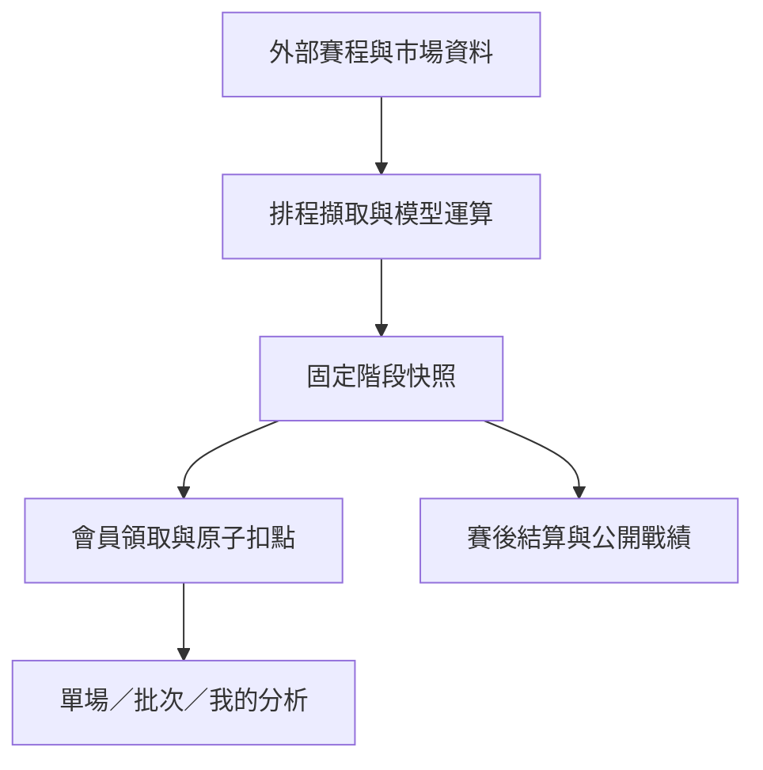

# PROJECT_NOTES — HABAO 哈寶體育 AI

> 交接基準：2026-11-15（Asia/Taipei）。讀者：後續維護工程師、其他 AI 助手、專案負責人 Andy。
> 這是現況說明與維護約束，不是授權執行部署、SQL 或付款的指令。本文未存放 API Key、JWT、管理員憑證或個人會員資料。

> **最新交接（2026-11-17）**：先讀 `docs/HANDOFF-20261117.md`（正式網址已搬到 **https://hbai-tw.pages.dev/**），再看 §14～§18。前一份：`docs/HANDOFF-20261115.md`、第 5 節 5a～5p。
>
> **分工（使用者 2026-11-15 決定）**：程式修改一律由 Claude 負責；GPT 負責審查、提出意見與規劃，不直接修改 repo 程式。GPT 的審查結果由使用者轉給 Claude 處理，處理後由 Claude 更新本檔。
> **交叉審查時機（2026-11-15 決定）**：模型與推薦算法、戰績結算、扣點與會員權限、資料庫結構與 SQL、準備換上正式版的新模型 → Claude 完成後主動提醒使用者交給 GPT 複審並附上要貼的內容；前後台畫面、文字、版面、小錯誤修正 → Claude 單獨完成即可。Claude 不照單全收 GPT 意見：同意的修改並說明；不同意的寫明理由交使用者決定，並記錄在回覆文件與本檔。

## 0. 接手先讀：證據、版本與操作權限

> **運作機制手冊**：`docs/SYSTEM_REFERENCE.md`（每個功能怎麼運算、資料從哪來寫到哪；哪些後端只在線上、repo 沒有）。本文件記規則與進度，兩份一起讀。

### 0.1 證據如何判讀

本文區分四種狀態：

- **程式碼確認**：已讀 GitHub／本地對應來源，可說明實作，但不代表 Supabase 正在執行同一版。
- **先前部署／實測確認**：本次對話或部署驗證檔曾記錄成功；只代表當時狀態。
- **本次確認**：交接整理時重新讀取 GitHub 的狀態。
- **待確認**：未取得當前後端資料、缺實場、欠回測或資料不足；不得自行補成「正常」。

重要區別：`Cron succeeded`、HTTP 200、`release_ready`、模板測試通過、預測準確率通過，是五件不同的事。排入 HTTP 佇列成功也不代表 Edge Function 已完成。

### 0.2 倉庫與部署

| 項目 | 位置／現況 |
|---|---|
| GitHub | `awu7757-sys/habao-football-ai` |
| 正式分支 | `main` |
| 前台 | **Cloudflare Pages：`https://hbai-tw.pages.dev/`**（2026-11-17 起；舊 GitHub Pages 網址過渡期自動轉址，見 §16） |
| Supabase 專案 | 名稱「哈寶足球AI」；project ref：`oqtbsbohcfeghgnykwxy` |
| 本次讀到的 main HEAD | `2c26f99cea83f603ce542d08b5dfbe501df69c27`（本文件之前） |
| 最近前台功能提交 | `0ad0c66b731ee4c84d3518c9ce7ac2da4481a0a2`：30D 戰績、首頁三球類統計 |
| 最近補充提交 | `2c26f99...`：唯讀排程檢查改成單一可匯出結果集 |
| 本次部署確認 | 上述 HEAD 的 `pages build and deployment` 已 `completed / success` |
| 文件本身 | 2026-11-15 由 Claude 提交至 repo 根目錄，並依程式碼核對結果補正（見 §13） |

**GitHub Pages 成功不等於 Supabase 已部署。** `supabase/functions/` 與 `deploy/` 有重複、歷史版及組合產物，不能任選一份覆蓋線上函式。請先比對最後部署紀錄、版本、原始碼雜湊與依賴。

### 0.3 使用者目前的授權

1. **Supabase 讀取與修改均已撤銷，連接已移除。** 不得改走 HTTP、SQL、CLI、瀏覽器或舊金鑰繞過。
2. **GitHub 可以直接讀取；每次修改須先取得使用者允許。** 本次五項前台改動已獲單次授權並完成，不能推論後續修改也獲授權。
3. 後端目前採「提供程式／SQL，由使用者自行執行」方式。
4. LINE 客服網址已於 2026-11-15 統一換為 `https://line.me/R/ti/p/@804dlhod`（見 §11）。
5. 使用者偏好：繁體中文、先說結論、操作要指出檔案、搜尋位置、替換起訖、保留區段與是否 Commit。

## 1. 專案目標與核心理念

HABAO 是供會員查看足球、NBA、MLB 賽前量化分析及公開驗證結果的網站／PWA。管理者能管理會員、積分、資料來源用量、正式快照與研究對照。

核心要解決的問題：

- 使用者無須自行彙整賽程、盤口、球隊近期表現、傷停與先發。
- 同一場同一階段的會員應看到同一份固定結果，不能因點擊時間、單場／批次入口不同而改變。
- 透過賽前封存與賽後驗證，避免事後改推薦、挑選好看的賽事或用完賽資料偽造賽前成績。
- API 呼叫集中在系統擷取／快取，會員優先讀快照，降低重複分析與成本。
- 缺資料要明確保留原因，不能把「沒有取得」當成「沒有傷停」，也不能製造盤口或信心值。

產品名稱中的 AI 不代表每場都呼叫 GPT／Claude。可見的主要路徑是程式化統計模型；LLM 影子程式存在，但先前決策為停用，不新增常態 LLM 成本。是否仍完全停用須以目前後端設定確認。

## 2. 系統架構

### 2.1 主流程



- 前台：靜態 HTML、CSS、原生 JavaScript，沒有確認為整站 SPA 框架。
- 登入與會員：Supabase Auth／OAuth 身分，搭配應用層會員資料與積分；舊帳號路徑仍有殘留。
- 後端：Supabase Edge Functions、Postgres、RPC、RLS、`pg_cron`、`pg_net`、Vault。
- 顯示時區：Asia/Taipei；儲存時間多為 UTC／timestamptz。NBA 官方來源另涉及美東日界及夏令時間。
- 靜態站版本由 GitHub Pages 更新；函式、Schema、排程、Secrets、會員開放設定各自獨立。

### 2.2 前台頁面與共用程式

| 檔案 | 職責 | 維護注意 |
|---|---|---|
| `index.html` | 登入／入口、Google／LINE OAuth、PWA handoff、客服 | LINE 登入與 LINE 客服不是同一件事 |
| `home-v2.html` | 目前新版會員首頁、三張統計卡、焦點賽事、工具入口、合作平台、客服浮鈕 | 最新統計已接三球類；焦點賽事區仍沿用既有足球內容 |
| `home.html` | 舊會員首頁 | 不要誤把舊頁當正式修改目標；所有導流是否已離開此頁待確認 |
| `football.html` | 名稱仍是 football，但實際為三球類賽事中心與「我的分析」主容器 | 今天／明天、球類切換、勾選批次、階段領取、歷史重看 |
| `analysis.html` | 足球／NBA 及共用結果呈現 | 單場、批次使用固定結果資料，不重新算模型 |
| `mlb-analysis.html` | MLB 結果入口 | 最近驗證與 `analysis.html` 同內容；後續不要分叉造成差異 |
| `performance.html` | 三球類公開戰績、命中走勢、驗證紀錄 | 最新預設 30D；驗證紀錄獨立固定近 30 天 |
| `mlb-performance.html` | MLB 戰績相關舊入口 | 和共用戰績頁的導航關係，重構前需核對 |
| `ai-tools.html` | AI 工具箱 | 由相關開關／入口設定控制 |
| `fund-plan-beta.html` | 資金計畫實驗頁 | 不應直接當作三階段核心功能 |
| `admin.html` | 管理中心，會員、API、功能開關、分析與公開戰績管理等 | 實際可用模組須依當前後端核對；存在其他 admin 外掛 JS |
| `admin-football-v2.js`、`admin-nba-v2.js`、`admin-baseball-v2.js`、`admin-nba-backtest.js` | 分球類研究／階段／回測管理畫面 | 研究資料與正式會員快照不可混用 |
| `sports-stage-core.js` | 階段、狀態、ID、歷史分組、推薦欄位等共用純邏輯 | 前台、驗證頁、測試共用；更改會跨球類影響 |
| `sports-stages.js`＋`sports-stages.css` | 正式三球類領取、單／批次、按鈕、歷史、顏色控制 | 會包裝舊頁面的函式；不能只改舊版 handler |
| `sports-analysis-contract.js` | 分析結果共用契約／顯示整合 | 保留球類、場次、階段識別及欄位語意 |
| `home-sports-stats.js` | 2026-11-15 新增首頁三球類唯讀彙總 | 不得在統計時呼叫 claim／capture／扣點 |
| `mlb-match-center.js` | MLB 賽程、球隊顯示、賽事中心適配 | 存在 legacy 開關與新版 controller 整合 |
| `nba-stages.js` | NBA 舊階段控制相容程式 | 不要與共用 controller 同時重複扣點／觸發分析 |
| `habao-i18n.js`、`opencc.js` | 繁中／簡中／英文、轉換 | 新文字需考慮三語；不能把 API 欄位名一起翻譯 |
| `habao-loading.js` | 非同步操作載入提示 | 使用者要求小型、自然，不要過大旋轉圖或冗長文字 |
| `habao-page-runtime.js`、`habao-back-to-top-v2.js` | 導航及回頂部 | 注意 PWA／返回行為 |
| `manifest.json`、`sw.js` | PWA 與快取 | 舊靜態資源可能影響驗收；不能靠重新扣點檢查新版 |
| `qa/sports-release/` | 三球類驗證／重播頁 | 預設合成資料；不是正式真實分析紀錄 |
| `qa/nba-stages.html`；根目錄的 `mlb-staging.html`、`mlb-verify-1024.html`、`line-login-test.html` | 歷史／專項驗證入口（後三者在 repo 根目錄，不在 `qa/`） | 不代表正式會員主路徑；刪除前先查引用 |

### 2.3 重要 Edge Functions

下列名稱從前台或部署來源確認；不是本次對線上函式的完整盤點。

| 領域 | 函式 |
|---|---|
| 登入／會員 | `oauth-member-login`、`member-login`、`pwa-handoff-start`、`pwa-handoff-claim`、`pwa-handoff-complete` |
| 足球 | `tomorrow-fixtures`、`match-analysis`、`member-analysis-history`、`football-v2-shadow-stage-runner`、`football-v2-stage-member`、`ai-performance` |
| NBA | `basketball-fixtures`、`basketball-analysis`、`basketball-member-analysis`、`basketball-member-analysis-history`、`nba-v2-unified-runner`、`nba-v2-stage-runner`、`nba-v2-stage-member`、`basketball-performance-api` |
| MLB | `baseball-public-fixtures`、`baseball-feature-config`、`baseball-analysis`、`baseball-member-analysis`、`baseball-member-analysis-history`、`baseball-v2-stage-runner`、`baseball-v2-stage-member`、`baseball-performance-api`、`baseball-public-picks` |
| 批次與跨球類 | `analysis-job`、`sports-release-verify` |
| 管理 | `admin-center`、`admin-benefits`、`admin-members`、`admin-basketball`、`admin-basketball-performance`、`admin-baseball`、各 V2 compare 函式 |
| 其他 | `public-stats`、`public-announcements`、`partner-platforms`、`toolbox-launch-settings`、`push-send`、`push-subscribe`、`upgrade-vip`、`fund-plan-beta`、`nba-model-backtest`、`admin-football-v2-compare` |
| 排程／後端互呼（只在部署檔出現） | `baseball-t10-job`、`public-prediction-runner`、`football-v2-shadow-stage-runner`、`nba-v2-stage-runner`、`baseball-v2-stage-runner` |

`supabase/functions/football-v2-llm-shadow-runner/` 原始碼仍在 repo；是否仍部署／排程待確認（見 §1 LLM 停用決策）。

`sports-release-verify` 的 capabilities 回應用於前台 controller 啟用；不要將其「能力可用」解讀成所有資料每日抓取均成功。所有診斷用臨時 action 完成後應還原，不得永久留下可被濫用的 probe。

### 2.4 Supabase 資料物件

以下為程式碼／SQL 能辨認的物件。欄位全集、索引、觸發器、RLS、筆數及線上存在狀態均須另以唯讀 SQL 確認。

| 分組 | 物件 | 用途 |
|---|---|---|
| 會員 | `members`、`member_analysis_history`、`basketball_analysis_usage`、`member_baseball_analysis_history` | 會員權限／點數與原有領取／歷史資料 |
| 管理 | `admin_users`、`admin_sessions`、`site_settings` | 管理員、工作階段及 API 方案／續費追蹤等設定 |
| 共用 | `analysis_jobs`、`api_usage`、`debug_logs`、`fixture_cache`、`match_analysis_cache` | 批次工作、用量、診斷及快取 |
| 足球正式 | `ai_prediction_snapshots`、`ai_backtest_summary` | 正式預測／結算；回測彙總須區分真實與模擬 |
| 足球 V2 | `football_v2_shadow_feature_snapshots`、`football_v2_shadow_fixture_calendar`、`football_v2_shadow_stage_snapshots`、`football_v2_shadow_stage_audit` | 特徵、賽程、階段快照、捕捉狀態 |
| 足球設定 | `football_v2_rollout_settings`、`football_v2_public_stage_history` | 全會員開放與有生效時間的公開階段選擇 |
| 足球領取／鎖 | `football_v2_stage_member_claims`、`football_v2_stage_capture_leases` | 會員固定結果與擷取互斥 |
| 足球球員／修正 | `football_v2_player_impact_cache`、`football_settlement_correction_log` | 球員統計快取；後者為單筆舊結算修復腳本的稽核紀錄，是否已套用待確認 |
| NBA 正式／研究 | `basketball_prediction_snapshots`、`basketball_v2_unified_snapshots`、`basketball_v2_box_cache` | T-10、統合研究、box score 快取 |
| NBA 階段 | `basketball_v2_stage_settings`、`basketball_v2_stage_snapshots`、`basketball_v2_stage_claims`、`basketball_v2_stage_api_budget` | 開放、T-2／T-15、領取、每日擷取成本 |
| MLB 正式 | `baseball_t10_snapshots`、`baseball_verified_results`、`baseball_opening_lines`、`baseball_team_stats_cache` | T-10、正式驗證、盤口紀錄、球隊快取 |
| MLB 研究／領取 | `baseball_v2_shadow_snapshots`、`baseball_member_refresh_state` | 研究與既有會員狀態；確切現役用途待確認 |
| MLB 階段 | `baseball_v2_stage_settings`、`baseball_v2_stage_snapshots`、`baseball_v2_stage_claims`、`baseball_v2_stage_api_budget` | 開放、T-2／T-15、領取與成本 |
| MLB 來源視圖 | `sports_mlb_t10_source` | 把 `baseball_t10_snapshots` 適配成 stage runner 輸入；僅服務角色使用 |
| 跨球類 | `sports_release_settings`、`sports_source_probe_requests`、`sports_source_probe_runs` | 發布開關、probe 請求與結果 |
| 其他 | `partner_platforms`、`push_subscriptions`、`live_score_push_state`、`live_score_push_targets`、`supabase_usage_snapshots` | 合作平台、推播、比分推送與用量追蹤 |

重要 RPC：

- `consume_member_analysis_credit(text)`：實際扣點規則的核心。**線上確認（2026-11-15 匯出）**，備份於 `supabase/sql/production-export-20261115/functions/consume_member_analysis_credit.sql`（僅紀錄，不可直接部署）。規則：
  1. 以 `members.account` 鎖定該列（`FOR UPDATE`）；找不到帳號回傳 `success=false`。
  2. **只有 `member_level='vip'` 才會扣 `daily_free_credits`**，且優先於付費點數；一般會員即使 `daily_free_credits>0` 也不會使用它。
  3. 每日免費用完（或非 VIP）時扣 `analysis_credits`（付費／儲值）。
  4. 兩者皆為 0 回傳 `success=false, consumed_type='none'`。
  5. **無限權限不在此函式**：三個 `claim_*_atomic` 在 `members.analysis_unlimited` 為 true 時直接略過呼叫。
  6. 函式為 `SECURITY DEFINER` 且未設定 `search_path`。EXECUTE 權限**線上確認**只有 `postgres`、`service_role`，anon／authenticated 不能直接呼叫。
- **會員等級與點數設計（使用者 2026-11-15 說明）**：首次註冊登入為一般會員，只有註冊贈送的 3 點，**沒有每日免費點數**；註冊前台連接的合作平台後直接升級為 VIP，才有每日免費點數。因此上述「只有 VIP 扣每日免費點數」符合設計，**不是 bug，不要改**。扣點順序對所有會員相同：先每日免費（只有 VIP 會有）→ 再付費／贈送點數。【線上確認】註冊送 3 點＝`members.analysis_credits` 預設值 3；VIP 每日補點由 `refresh_vip_daily_credits` 以台灣日期重設為 2（不累積），沒有排程，當天第一次觸發時才補。升級 VIP 的 Edge Function `upgrade-vip` 原始碼仍待匯出。
- `claim_football_v2_stage_analysis_atomic(...)`、`claim_nba_stage_atomic(...)`、`claim_mlb_stage_atomic(...)`：領取與扣點在同一交易完成，重複領取回傳舊結果。
- `reserve_football_v2_stage_capture_lease(...)`／`release_football_v2_stage_capture_lease(...)`：足球擷取鎖。
- `acquire_nba_stage_capture(...)`／`acquire_mlb_stage_capture(...)`：NBA／MLB 階段租約。
- `reserve_nba_stage_api(...)`／`reserve_mlb_stage_api(...)`：擷取成本預留。
- `update_football_v2_rollout_settings(...)`：足球開放與公開階段管理。

NBA／MLB 階段快照以 `(game_id, stage)` 唯一，領取以 `(account, game_id, stage)` 唯一。足球相同概念使用 `fixture_id`，並有 `claim_state`。舊不完整 processing 資料不能猜測是否扣過點。

### 2.5 排程與外部 API

| 項目 | 設計／已知設定 | 現在是否正常 |
|---|---|---|
| 各球類 T-10 | 系統自動產生正式快照；NBA 先前設計每 15 分鐘掃描 | 精確線上 job、各球類頻率與最後成功時間待確認 |
| 足球 T-2／T-15 | 每分鐘 runner 掃描；當前窗口內可有限重試 | 來源文件確認，現役 job ID／active 待確認 |
| NBA T-2／T-15 | `habao-nba-v2-stages-every-minute`，`* * * * *` | 最近 SQL 有此設定，線上每日執行待確認 |
| MLB T-2／T-15 | `habao-mlb-v2-stages-every-minute`，`* * * * *` | 同上；無賽事不能單以沒有新快照判定故障 |
| 賽後驗證 | 先前規劃約每 30 分鐘檢查比分／結算 | 三球類最新紀錄、積壓與目前頻率待確認 |
| 影子／研究 | 有舊 V2/V3、統合模型與移除舊排程腳本 | 不可假設舊排程已全部停用；需現況盤點避免重複成本 |

| 來源 | 使用目的 | 限制／費用注意 |
|---|---|---|
| API-Football／API-Sports Football | 足球賽程、球隊、歷史、傷停、先發、球員統計 | 先前 PRO 7,500 requests/day；到期與帳單以供應商為準 |
| API-NBA／API-Sports NBA | NBA 賽程、比分、歷史、box score | PRO 7,500/day；**不是 API-BASKETBALL 訂閱** |
| API-BASKETBALL | 程式保留 FIBA 世界盃相關路徑 | NBA 主服務不應誤改用此產品；世界盃啟用窗口待確認 |
| The Odds API 20K | 三球類市場盤口／賠率 | 20,000 credits/月；不能當成 20,000 次固定成本請求 |
| ESPN 公開 NBA 資料 | NBA 傷停、單場資訊、近五場球員統計 | 可能限流、缺欄位、時間不一致；沒有正式 SLA 保證 |
| NBA 官方 daily lineups | NBA 確認／預估先發、active／inactive | 需驗證球員數、位置、確認狀態、時間與雙方匹配 |
| MLB Stats API | MLB 賽程、球隊、投打、名單、傷兵與先發 | 來源可用不等於當場打線已公布；目前無新增付費 MLB 資料商 |
| Google／LINE OAuth | 會員登入 | 不能把客服 URL 替換誤套用至 OAuth |

Secrets 只記名稱、不記值：`API_NBA_KEY`、`API_FOOTBALL_KEY`、`THE_ODDS_API_KEY`／`ODDS_API_KEY`、`FOOTBALL_V2_STAGE_CRON_KEY`、`BASKETBALL_T10_CRON_KEY`，以及 Supabase 服務角色等。NBA／MLB stage SQL 曾共用 Vault 名稱 `nba_v2_cron_key`；修改時須同步函式驗證與排程 header。

## 3. 預測演算法與模型

### 3.1 共通限制與解釋方式

- **正式會員已開放 ≠ 統計模型已完成準確率校準。** 多份資料保留 `research_only:true`、`formal_recommendation:false`、`uncalibrated:true`，用來記錄模型來源／成熟度，不能任意刪旗標來宣稱準確率已驗證。
- 三階段代表不同資料截止點與快照，不保證模型相同、不保證方向一定改變，也不保證 T-15 比 T-10 更準。
- 單場與批次必須讀取同場、同階段相同的 `result_data`，不是單／批次各跑一套算法。
- 信心值是模型輸出或其轉換，不等於經校準的實際長期命中率。缺信心值不得製造假百分比。
- 以下參數多是保守啟發式及工程限制。未找到專案完整的獨立樣本回測與最佳化證據，不能說是訓練出的最佳權重。

### 3.2 足球

**來源與版本**：`deploy/sports-release-20261113/football-v2-shadow-stage-runner.index.txt` 可見 `football-v2-poisson-player-impact-0.3.0`；另引用 `football-v2-poisson-shrinkage-0.2.1`。T-10 仍沿正式快照／既有入口；全量當前正式 T-10 算法與部署版本需核對，不能把所有歷史都叫 V2。

球隊層：

1. 使用近期、對手調整後的進失球、主客場、賽季特徵與聯賽平均基準。
2. 收縮公式：`shrunk = n/(n+5) × observed + 5/(n+5) × league_prior`。聯賽基準缺失會報錯，不直接用任意固定進球數填補。
3. 賽季與近期資料避免重複加權：賽季權重上限 `0.4`，再乘扣除近期重疊後的獨立樣本比例。
4. 場地倍率先限制在 `0.85～1.15`，再依 `n/(n+5)` 收縮到 1。
5. 主隊期望進球約為「主攻＋客防」平均，再乘主場倍率並加球員修正；客隊相同。兩隊 xG 各限制在 `0.15～4`。
6. 以獨立 Poisson 的 0～18 進球網格，重新正規化機率，計算主／和／客、大小球、BTTS、最可能比分及公平賠率。
7. T-2／T-15 會員轉換器會檢查有效市場盤口與雙邊賠率，對大小與讓分比較期望回報、支援四分之一盤。**選最高 EV 不代表 EV 必為正**；不應把「有推薦」等同「保證正報酬」。

球員層：

- 使用 API-Football 傷停、先發及球員出賽、進球、助攻、防守動作、守門員失球資料。
- 可用常規球員樣本要求至少 270 分鐘且至少 1 次先發，按先發數／分鐘建立基準 XI。
- 攻擊貢獻用進球＋助攻每 90 分鐘，乘隊內進球／進球助攻合計換算率（限制 `0.35～0.85`），再以 `minutes/(minutes+900)` 收縮。
- 比較確認 XI，或排除已列傷停後的可用 XI，與基準 XI 的差別。不能把預估 XI 對外稱為確認先發。
- 攻擊修正上限 ±0.35 xG；防守動作對對手 xG 修正 ±0.25；更換守門員失球率修正 ±0.25。
- 球員快取 24 小時；`supabase/functions/football-v2-shadow-stage-runner/index.ts` 的 `teamPlayerStats` **目前只抓 `page=1`**，多頁時標為 `fresh_partial`／`cached_partial`。程式碼確認尚未升級分頁；線上是否同版待確認。
- 部署後捕捉可套用球員修正；既有封存資料不回寫。資料不完整則保留原因與基礎模型。

早期特徵設計曾採近 12 場、場地各 12 場，依 8→6→4 降階及跨季備援。**當前特徵生成器的完整取樣／分頁實作不全在此次核對來源中，待確認**，不得把這段規劃當成已確認現役參數。

### 3.3 NBA

**T-10**：既有正式量化模型路徑，曾標為 `habao-nba-quant v1.0`（此字串在 repo 中找不到，僅為對話紀錄）。本次沒有重新取得其完整正式線上碼，精確參數待確認。

**T-2／T-15**：統合效率模型＋貝氏比分備援，使用 `nba-v2-unified-efficiency-shrinkage-v0.2` 的計算核心，另外由 stage runner 封存當階段市場與球員修正。

資料：

- 本季／前季最多 24 場有效完成賽事；按時間排序去重。
- 過濾非目標聯盟、錯球隊、異常比分、未完成或不符合截止點的比賽。
- Box score 含 FGA、FTA、進攻籃板、失誤、實際得分；必須雙方可核對。

效率主模型：

```text
回合數估計 = 0.976 × (FGA + 0.44 × FTA − OREB + TOV)
ORtg = 每 100 回合得分
DRtg = 由對手得分效率建立
時間權重 = 本季 1／前季 0.6 × 0.5^(資料日齡 / 110)
先驗 = 6 場、99 回合、ORtg／DRtg 114
預估回合數限制 = 90～108
主隊分數 = 回合數 × (主 ORtg + 客 DRtg) / 200 + 1.8
客隊分數 = 回合數 × (客 ORtg + 主 DRtg) / 200
雙方預估分數各限制 = 85～143
```

每隊少於 3 場有效 box score 時，改用比分備援，不捏造效率。效率路徑的分差／總分標準差取自比分模型的 `margin_sigma`／`total_sigma`（缺值時預設 16.3／20），再限制 10.5～22／13～27。

比分備援：

- 攻防平均向 113.5 分、5.5 場先驗收縮。
- 權重：本季 1／前季 0.62，110 天半衰期，再乘 `0.98^排序位置`。
- 主客場偏差係數 0.22，按場地樣本再收縮，上限 ±2 分。
- 主場固定加成 2.2 分；兩隊預估分數各限制 88～138。
- 歷史分差／總分變異向先驗 185／300、權重 7 收縮；額外加入不確定性後，標準差限制為分差 10.5～22、總分 13～27。
- 用常態 CDF 換算獨贏、過盤、大小分機率。方向門檻：≥0.55 或 ≤0.45；中間區間「暫不推薦」。盤口缺失亦不提供該市場有效推薦。

球員修正（T-2／T-15）：

- ESPN 傷停＋NBA 官方確認先發，核對隊伍、主客、時間、賽季及狀態。
- 先發須每隊 5 位不重複球員、位置有效、Active 且 Confirmed；Expected 不當作確認。
- 缺陣採 Out／Suspended 或官方 Inactive；Questionable／Probable 不猜機率。來源衝突保留紀錄並排除該筆不可靠修正。
- 近五場球員分鐘／正負值，至少三場有效；團隊分鐘正規化至 240。
- 個人相對隊內每 48 分鐘正負值，以 `minutes/(minutes+450)` 收縮並限制 ±8；輪替再分配，單隊修正上限 ±1.5 分，雙方相對分差最多 ±3 分。
- 新確認先發的分鐘調整最多 `6 × (1 − 近期先發率)`；轉替補減少 `6 × 近期先發率`，然後重新正規化。
- 長期缺陣且近五場已不在輪替的球員不再重扣；「有傷停資料但修正 0」不必然是 bug。
- **目前只調整分差、獨贏與讓分。總分球員修正尚未實作。** 不得宣稱傷停已修正所有市場。
- 正負值估算不是因果 on/off 或 RAPM；尚未完成歷史校準。

### 3.4 MLB

**已完成球員接入**：先前部署確認 `baseball-analysis v35` 與 `baseball-v2-stage-runner v2`。三階段共用 `mlb-player-adjustment.js`。這不代表所有賽事都有完整資料、必然套用修正或經實場驗證。

基礎得分模型：

1. MLB 官方球隊賽季場均得分／失分，至少 5 場。
2. 混合近最多 10 場，近期權重 `0.25 × min(10, 有效場數)/10`；不足按樣本降權。
3. 預期得分由本隊攻擊與對手防守各占 50%。
4. 已知先發投手 ERA 與團隊 ERA 差異乘 0.15，需至少 20 局；對對手得分影響限制 ±0.65。
5. 主場加 0.14 分；單隊預估得分最低 0.5。
6. 預估得分差決定獨贏；總分與實際 total line 比較；主分差＋主讓分線決定讓分方向。沿用正式方向規則，不因平台盤不同改成暫不推薦。

球員修正：

| 部分 | 條件與計算 |
|---|---|
| 確認九人打線 | 9 位唯一打者、樣本齊全、無傷兵衝突；球隊合計 ≥500 PA；打者 OPS 依 PA/(PA+100) 向團隊 PA 加權 OPS 收縮 |
| 打線效果 | 九人等權平均 OPS 相對基準的差，限制 ±20%；只作用在原攻擊的 50% 部分，不虛構棒次 PA 優勢 |
| 未公布打線的傷兵 | 有有效現役 roster；傷兵打者 ≥30 PA；由現役較低 PA 替補池估計，替補池 ≥30 PA，依歷史 PA 比例計算 |
| 避免重複 | 確認打線效果與打者傷兵效果互斥，不能缺一名球員扣兩次 |
| 牛棚傷兵 | 後援至少 10 IP、先發／出賽比例 <0.2；現役後援池 ≥20 IP；ERA 以 20 IP 先驗向球隊收縮；對手得分修正上限 ±0.35 |
| 先發投手衝突 | 預估先發同時列為確定缺陣時，略過原 ERA 修正；不虛構替代投手 |
| 缺資料 | 標示 skipped／reason，保留基礎模型；不能將不存在資料填成 0 |

模型保留獨立 Poisson 的九局得分代理研究輸出：可算九局勝負／和局、大小、讓分機率；非和局正規化只是 moneyline proxy，**不是延長賽模型**。尚未完整處理得分相關性、過度離散、天候與延長賽。部分舊限制文字仍寫未含牛棚，與新版「牛棚傷兵啟發式」不同，需整理描述而非假設已完成整體牛棚模型。

另需核對：stage runner 傳給 `projectedProbabilityResearch` 的 odds metadata 與其 `trustedMarket` 條件是否完整一致。缺 bookmaker 數或 observed_at 會使研究盤口機率／EV 空白；正式方向路徑另計，不能為補研究欄位而改歷史正式推薦。

## 4. 三球類的開放、領取與公開驗證規則

### 4.1 共通會員時序

| 時段／狀態 | 顯示及行為 |
|---|---|
| 距開賽超過 10 小時 | 尚未開放；按鈕顯示賽前 10 小時開放 |
| T-10 小時起至 T-2 前 | 金色 T-10 賽前分析；首次成功領取通常扣 1 點 |
| T-2 小時起至 T-15 前 | 藍色 T-2 深度分析 |
| T-15 分鐘起至開賽前 | 紫色 T-15 最終分析 |
| 已領當階段 | 等待下一階段／顯示開放時間；重看由「我的分析」進入 |
| 已開賽 | 不再新增賽前領取，顯示分析已截止 |
| 已完賽 | 獨立灰色已完賽狀態，不能和比賽進行中混為一談 |

**T-10、T-2 是小時，T-15 是分鐘。** 舊訊息出現 T-1 不代表新增了 T-1 正式規格。

- 三階段為獨立快照；一般會員各階段首次成功領取各扣一次，同階段重看不扣。
- 扣點失敗、存檔失敗、沒快照、沒有權限不得留下「已扣點卻沒結果」；由原子交易及唯一鍵保護。
- 前台 pending 防重僅是體驗，不能取代資料庫防重。跨分頁、重試仍須後端 idempotent。
- T-15 時可補領已存在的 T-2；若不存在，不能用此時資料倒做過去 T-2。
- 會員點擊可觸發符合當前窗口的遺漏快照補抓，這是系統排程失敗的受控備援，不是每個人重算不同結果。
- 開賽後不得補抓為賽前資料；快照完成時間而非請求開始時間決定是否合格。
- 「我的分析」同場一張卡、三階段按鈕，重看不扣點。歷史一般顯示至開賽＋8 小時。**注意：每日清理排程會刪除 `member_analysis_history`（足球 T-10 領取紀錄）中 7 天前的列**（見 `docs/SYSTEM_REFERENCE.md` §11）；NBA／MLB stage claims 不受影響；各 legacy endpoint 的精確一致性待核對。
- 今天／明天以台灣日期切換；跨午夜與夏令時間是必要回歸案例。

### 4.2 分球類特別規則

| 球類 | 擷取與會員 | 公開驗證 |
|---|---|---|
| 足球 | T-10 正式流程；T-2／T-15 Poisson＋球員模型；有補抓模式及 lease | 公開階段依管理設定與生效時間歷史選用；舊賽事不回寫。使用者目標是最終 T-15，**現在實際設定待確認**。晚補抓不列準時公開比較 |
| NBA | NBA 正式賽事為主；T-10 舊正式模型；T-2／T-15 統合模型；資料端有世界盃獨立窗口 | 最近變更保留原正式公開來源，沒有證據證明已全面改成 T-15；當前 verifier 及階段待確認 |
| MLB | 僅 MLB；賽程來源過濾 R/F/D/L/W 類型；三階段有共用球員修正 | `baseball_verified_results`／既有正式來源；不能因會員三階段已開放就假設公開戰績改成 T-15 |

結算必須使用封存推薦、原盤口、原方向及正式比分。走盤、半贏、半輸與有效樣本分母要保留。棒球／籃球前台不需顯示預測比分，內部預期分數仍可作模型運算及稽核。

### 4.3a 2026-11-15 載入提示與戰績頁修正

- 使用者要求：切換時要清楚知道正在緩衝，不要以為當機（取代先前「小型、自然」的偏好）。
- `habao-loading.js`（全站共用，版本參數改 `?v=2`）：延遲 230→120 ms；提示膠囊加大（14px、金框）並移到底部導覽列上方；新增頁面頂端金色進度條。
- `analysis.html`／`mlb-analysis.html`：恢復足球 BTTS 卡片（11-13 `dc8991a` 三球類統一時被刪；使用者確認只有預測比分不顯示，BTTS 要顯示）。兩檔維持完全相同。
- 「我的分析」載入：一進入立即顯示「我的分析讀取中…」與全站提示；同帳號 5 分鐘內的紀錄先從 `sessionStorage.habao_history_cache_v1` 立即顯示，背景重新讀取後更新（若會員已離開我的分析畫面則不覆蓋）。
- 結果頁返回：從「我的分析」點開的結果，左上角顯示「我的分析」，回到 `football.html?view=history&history_sport=<球類>` 同一球類分頁；從賽事中心分析（單場／批次）維持「賽事中心」。來源以 `sessionStorage.habao_analysis_return` 標記（`sports-stages.js` 的 `viewHistory` 設定、`open`／`batch` 清除）。`sports-stages.js` 版本參數改 `?v=20261115`。
- **三球類共用同一套模板（使用者確認為長期規則）**：賽事卡片按鈕／顏色／補領／批次勾選由 `sports-stages.js`（configs：football、basketball、baseball）統一產生，足球舊的 `renderFootballV2StageButton` 已被覆蓋為空函式；時段判斷用 `sports-stage-core.js`；結果頁 `analysis.html`（`mlb-analysis.html` 必須與其完全相同）；我的分析 `renderHistory`。日後 T-10／T-2／T-15 的任何顯示修改都改這幾個共用檔，不要在單一球類頁面分叉。
- 【使用者決策 2026-11-15】賽事卡片上「重看 T-x 分析」批次勾選移除：本階段已領取時隱藏批次勾選，重看一律到「我的分析」（`sports-stages.js`，版本 `?v=20261115b`）。補領按鈕保留。`deploy/nba-stages-20261113/stage-batch-tests.cjs` 修改前後皆 14 過 9 失敗（舊測試，待整理）。
- 「補領 T-10／T-2」按鈕：是在後段時間領取**尚未領過**的前一階段快照（首次會扣 1 點），不是重看；已領過的階段不會出現補領，重看一律在「我的分析」。
- `football.html`「我的分析」：預設分頁為當下所在球類（原本即如此）。五支歷史 API 原本依序等待，改為同時發出；改用 `habaoHistoryFetch` 對 5xx／429／網路錯誤最多重試 2 次。
- 已知舊測試失敗（修改前後相同，非本次造成）：`tests/football-ui.test.cjs` 1 項、`tests/nba-batch.test.cjs` 4 項、`tests/nba-frontend.test.cjs` 1 項，`football-atomic`／`football-settlement-repair`／`nba-live-settlement` 需 PGlite 等依賴無法直接執行；待整理。
- 頁面可設 `<body data-habao-loading="bar">` 只保留頂部進度條、不顯示底部提示；`performance.html` 已設定（避免與頁內「戰績讀取中…」重複）。
- `home-sports-stats.js`：首頁十多個唯讀請求遇 5xx／429／網路錯誤最多重試 2 次（600、1500 ms），4xx 不重試；公開驗證總數同分頁 5 分鐘內沿用 sessionStorage（`habao_home_verified_v1`）。測試：`node tests/home-stats-retry.test.cjs`。
- `performance.html`：切換球類／區間時舊內容變暗，上方顯示「足球／籃球／棒球 戰績讀取中…」，不再先顯示 0 或 --；同球類＋區間 5 分鐘內重用已取得的資料（切回立即顯示）；AI 命中走勢不再把「尚無已驗證場次」的日子畫成 0%（修正 NBA 顯示 +65% 假上升）。

- 【使用者決策 2026-11-15】公開戰績中既有的英冠／美職／墨超／歐協聯歷史紀錄**保留不動**（不刪、不排除），以證明沒有事後挑選；新賽事已不再加入這 4 個聯賽。首頁公告文字由使用者在後台自行維護，程式不更動。

### 4.3 2026-11-15 最新前台調整

- `performance.html`：進入或切換球類時，上方區間及走勢都預設 30D。
- 驗證表另存 `recordsData`，固定取 `days=30`，以前端時間再次排除未來／超過 30 天／無效 kickoff；「查看更多」只能展開此集合。
- 走勢切到 7D 不縮小驗證表；非同步回應有序號與球類檢查，避免較晚返回的舊請求蓋掉新版。
- 首頁「可分析」讀今天＋明天三球類，用共用 stage decision 與會員 status 計算目前主按鈕可操作場次；已領取而等待下一階段不算現在可操作。
- 首頁「已分析」取各球類歷史＋NBA／MLB stage history，以 `球類:賽事ID` 去重，不把三階段算三場。沿用可見歷史範圍，不是終生累計。
- 首頁「公開驗證」加總三個 API 的 `summary.verified_matches`，沿用 API 的全期間範圍；**不是只算 30 天，也不是市場項目數**。
- 任一來源失敗時顯示 `--`，不拿足球部分總數假冒三球類合計。
- 13 項本機程式／DOM 檢查通過；實際瀏覽器視覺測試因環境 Chromium socket 權限失敗，**未完成視覺驗收**。未呼叫正式 Supabase API。

## 5. 重要設計決定與放棄／限制的方案

| 決定 | 原因／後果 |
|---|---|
| 由系統自動快照取代會員各自重算 | 保持一致、減少 API 成本、提供可追溯公開戰績 |
| 由舊「六小時後重分析」轉為三階段 | 明確時間窗與收費單位；舊重分析狀態不能再支配新版 |
| 停止永久限制單一測試帳號 | 使用者要求正式全會員模式；仍需驗證後端 gate，前台不顯示測試標籤 |
| 共用單場／批次契約 | 避免同場同階段結果不同、重複扣點與錯誤跳轉 |
| 結果頁移除階段快照說明與傷停／先發資料面板 | 使用者要求版面簡潔；只移除顯示，不能刪除後端證據或停止修正 |
| NBA 效率＋比分備援整合 | 降低 V1/V2/V3 名稱混亂；不是把不同模型結果隨意平均 |
| 不猜測 Questionable 出賽率／未公布先發 | 防止把假設包裝成已確認資料 |
| 不無限往前找歷史 | 舊賽季不等於當前實力，需時效降權／有效樣本門檻；缺資料保留缺資料 |
| 不把 Panda 盤口相同當作上線前提 | 使用者明確要求以實際資料源盤口呈現；不同平台盤差不能自行改推薦線 |
| 不用目前來源重建舊賽前快照 | 防止未來資訊洩漏；歷史 probe 只證明來源與程式能讀，不構成回測 |
| 未達優勢或缺市場時暫不推薦 | 不為了讓每張卡有方向而編造數字；MLB 現行方向規則與 NBA 門檻不同 |
| 不自動用 AI 語言模型代替量化核心 | 先前 LLM 影子路徑停用，控制成本；未驗證方案不得直接替代正式模型 |
| Supabase 改回由使用者執行 | 使用者收回直接讀寫權限；技術能力不構成授權 |

## 6. 目前完成度與證據

### 6.1 已完成，但須理解證據範圍

| 項目 | 完成狀態／依據 |
|---|---|
| 三球類賽事中心與階段顏色 | 已部署共用 controller；使用者先前驗收按鈕／文字正常 |
| 已開賽／已完賽模板 | 共用 lifecycle 與灰色完成狀態已實作；後續新增 API status 必須補測 |
| 我的分析三階段分組／免費重看 | 使用者回報正常，NBA 正式資料重看未扣點 |
| 單場／批次一致性 | 共用 claim 與結果契約，使用者已有前台驗收；不是全時段所有球類實場皆驗證 |
| 結果頁紅框面板移除 | 已部署，後端資料仍保留 |
| MLB 傷兵／打線納入運算 | `baseball-analysis v35`、`baseball-v2-stage-runner v2` 先前部署及讀回比對成功 |
| MLB 程式驗證 | 15 球員單元＋5 整合＋8 原子＋45 契約＋2 runner，共 75 項紀錄；不是準確率回測 |
| NBA 正式來源恢復 | 2026-11-14 API-NBA 續訂後，today 9 場、tomorrow 5 場曾實測 HTTP200；不是持續可用保證 |
| NBA 續費卡片修正 | 使用者已提交 `53ddf1a...`，同步 `nbaProviderUsage` 避免舊日期優先顯示；重新整理後實際畫面待使用者回報 |
| The Odds 續費前台邏輯 | 已讀 GitHub，原本就有同步 provider metadata；尚未證明付款／後端日期正確 |
| 30D 戰績與首頁三球類統計 | 最新兩提交已 Pages 部署成功；13 項 mock／DOM 測試通過，正式瀏覽器與 API 端到端仍待驗收 |

### 6.2 先前實際資料證據

- NBA 2026-11-14 九場（17115～17123），T-2／T-15 合計 18 筆 ready 曾核對。
- 當時 T-2 先發為 expected，不套確認先發修正；6/9 場有傷停修正，其餘符合「近期輪替未變」等條件，不是硬扣分。
- 當時 T-15 傷停與確認先發有讀到，9 場球員分差修正均非零；沒有因此證明模型比舊版更準。
- 曾檢查 5 筆既有會員領取與快照，mismatch 0；不能擴大成今日所有會員全部一致。
- MLB source probe request 77653、game 849799 曾回應成功：可讀到兩隊打者／投手與九人打線，執行到修正邏輯，`snapshot_written=false`、無會員扣點。
- **該 MLB probe 是歷史場次＋當前來源核對，不是當時的賽前重建。** 新版 MLB 尚缺下一場真實 T-10／T-2／T-15 全鏈路驗收。

### 6.2a 2026-11-15 快照準時度盤點（`deploy/fixes-20261115/08_snapshot_timeliness_readonly.sql`）

- 設計原則（使用者確認）：三球類三階段都由系統先建立唯一快照；系統沒建立時，第一位會員觸發的也是同一套正式分析，產生的唯一快照供之後所有人沿用。目標是系統自己準時建立，會員補位只是最後保險。
- 足球 T-10：近 14 天 171 場中 170 場在開賽前 9.5～10.5 小時建立。補抓佇列 26 場「開賽仍無快照」，研判為日職／韓職／中超／巴甲缺特徵所致（11-15 已修）。T-2／T-15 多數 scheduled，少數 late_pre_match_recovery；`unknown` 為舊版未記錄 capture_mode。
- NBA T-10：100／100 準時（賽程快取 103 場，差 3 場待查，可能延賽或非正式賽）。T-2／T-15 只有 13 場，符合 11-13 才上線；上線後的場次都有。
- MLB：近 60 天 5 場 T-10 全準時；T-2／T-15 無資料（11-13 上線時已休賽）。
- 結論：**目前不需修改 NBA／MLB 建立流程**。NBA／MLB 的 T-2／T-15 依賴 T-10 在開賽前 8～10.5 小時內建立（`acquire_*_stage_capture`），為潛在風險，建議每週用 08 查詢追蹤。

### 6.2b 2026-11-15 用量盤點（`deploy/fixes-20261115/09_usage_overview_readonly.sql`）

- Supabase 為免費方案額度（帳單週期 11-13～12-13）：資料庫 0.119／0.5 GB（24%）、儲存 0.031／1 GB。`edge_function_used`、`egress_used_gb` 顯示 0，與每天約 7,000 次排程呼叫不符，研判 `usage-snapshot` 沒有取得這兩項真實數字，需以 Supabase 後台 Usage 頁為準。
- API-Football（V2 runner）：每日 19～338 次／7,500。API-NBA 總用量：每日 103～395 次／7,500。NBA 階段：nba 31～61、odds 22～26／日（odds 約每月 750 點／20,000）。MLB 階段：休賽期 0。
- **Egress（流量）是主要風險**：Supabase 後台顯示 11-13、11-14 每天約 500 MB，推算每月約 15 GB，免費額度 5 GB。執行次數 2 天 19,452 次，推算每月約 30 萬次／50 萬。
- 流量主因：足球 feature runner 與 stage runner 每分鐘各讀一次 3 天份 `football_v2_shadow_fixture_calendar`，該快取存的是 API-Football 全世界賽程（每天最多約 1,000 場、約 1 MB），支援聯賽只有 0～2 場（`deploy/fixes-20261115/10_egress_suspects_readonly.sql`）。修正：兩支 runner 寫入快取前只留 12 個支援聯賽；`11_shrink_fixture_calendar.sql` 可立即縮小既有快取。2026-11-15 07:09 使用者已執行縮小，每日快取由約 1 MB 降到 0～0.002 MB。兩支 runner 新版（只快取支援聯賽）使用者確認已部署。待隔日在 Usage → Egress 確認每日流量下降（修正前約 500 MB／日）。
- 結論：外部 API 額度使用率皆在個位數百分比，不需調整。長期最可能先碰到的是免費方案資料庫 0.5 GB 上限，建議每月檢查。MLB 休賽期排程只耗執行次數、不耗 API，是否暫停視後台實際執行次數決定。

### 6.2c 2026-11-15 當下無法確認、需之後回頭驗證的項目

| # | 項目 | 何時、怎麼確認 | 預期結果 |
|---|---|---|---|
| 1 | Egress 是否下降 | 11-16 起看 Supabase Usage → Egress 每日長條 | 明顯低於 11-13／11-14 的約 500 MB／日 |
| 2 | 日職／韓職／中超／巴甲開始有 T-10／T-2／T-15；英冠／美職／墨超／歐協聯不再新增 | 國際賽週後（約 11-21 起）跑 `deploy/fixes-20261115/04_football_league_coverage_readonly.sql` | 4 個新聯賽有場次，4 個移除聯賽不再增加 |
| 3 | 足球 T-10 補抓佇列「開賽仍無快照」(expired) 是否歸零 | 數天後跑 `08_snapshot_timeliness_readonly.sql` | 新賽事 expired 接近 0 |
| 4 | feature runner 10 小時內補救是否生效 | 遇到晚出現的賽事時看 `match-analysis` 日誌 | 不再出現 `FOOTBALL_V2_FEATURE_SNAPSHOT_MISSING` |
| 5 | NBA 賽程 103 場 vs T-10 100 場，差 3 場的原因 | 查 `basketball_fixture_cache` 與 `basketball_prediction_snapshots` 差集 | 應為延賽／非正式賽 |
| 6 | 舊管理密碼後門開關是否被其他後台函式採用 | 11-15 已查：`admin-basketball` 讀同一開關、`admin-baseball` 只用 admin-center 登入（無密碼路徑）；剩 `admin-benefits` 等未匯出者待查 | 都讀同一開關 |
| 7 | 新會員首次 LINE 註冊（送 3 點、登入禮、加好友開關） | 有從未登入過的 LINE 帳號時實測 | 正常註冊並出現加好友開關 |
| 8 | Log Query 用量偏高（2.5 天 26.9／100 GB） | 下週看 Usage | 回落；若持續偏高需找查詢來源 |
| 9 | `usage-snapshot` 記錄的 edge_function_used、egress 為 0（不準） | 匯出 `usage-snapshot` 原始碼檢查 | 修正或改以後台為準 |
| 10 | 11-13 疑似第 3 點扣點 | 匯出 `basketball-member-analysis` 檢查 T-10 重看是否重扣 | 使用者決定暫緩 |
| 11 | 足球新規則（獨贏與熱門相反不推、讓分主盤、BTTS 58%）是否生效 | 11-16 起抽查足球 T-10／T-2／T-15 分析結果與原因文字 | 出現「模型方向與莊家看好的一方相反」「採用最多莊家開出的主讓分盤」「把握不足」 |
| 12 | NBA T-10 獨贏門檻 70 是否生效 | 11-16 起抽查 NBA 分析 | 信心 60～69 的場次顯示「模型信心低於 70」 |
| 13 | `public-prediction-runner` 只收 12 聯賽 | 聯賽恢復後看該函式 Logs 中 `mode:"normal"` 的 `skipped_non_public_league`、`unknown_league_id` | 有跳過數；unknown 接近 0；**11/21 確認**：11/16 起公開快照只有日職 10、巴甲 9、韓職 4、德甲／法甲／西甲各 1，無非 12 聯賽；07:00 normal 報告 `unknown_league_id:0`、`skipped_non_public_league:0`（當次無非 12 聯賽進入） |
| 14 | 賠率隊名配對改良後 `fixture_not_matched` 是否下降 | 數天後重跑 `deploy/analysis-20261115/03_football_stage_export_readonly.sql`，看 market_context.status | 由約 20% 明顯下降 |
| 15 | MLB 公開戰績排除／刪除 | MLB 有實場或需要時實測一筆排除再恢復 | 前台公開戰績同步消失／恢復；刪除後不會被 30 分鐘補驗證補回 |
| 16 | 只領 T-2／T-15 的會員收得到 NBA／MLB 比分推播 | 下次手動開啟某場推播時實測 | 會收到 |
| 17 | 新規則前後命中率比較、市場融合研究樣本外結果、是否改公開 T-15 | 11-30 重跑 `deploy/analysis-20261115/01`、`03`，看後台研究表「樣本外」 | 規則有效則保留；研究版本需不同賽事約 200 場才考慮正式化 |
| 18 | API-Football 方案到期 | **11-30 前續費** | 續費完成 |

**11/21 中期檢查（11/16～11/20，樣本小，只觀察不調整）**：`deploy/analysis-20261121/01`（覆蓋）＝NBA 38 場、足球 15 場三階段全齊。`02`＋足球階段以 `toAnalysis` 重算的命中率：
足球 T-10 獨贏 38.5%（13）、讓分 53.8%（13）、大小 33.3%（15）、BTTS 57.1%（7）；足球 T-2／T-15 獨贏 40.0%（15）、讓分 54.5／53.8%、大小 38.5%、BTTS 57.1%（7）。
NBA T-10 獨贏 68.6%（35）、讓分 46.7%（15）、大小 50.0%（14）；NBA T-2 獨贏 37.5%（16）、讓分 53.3%（30）、大小 50.0%（30）；T-15 獨贏 37.5%（16）、讓分 51.6%（31）、大小 48.5%（33）。
觀察：足球國際賽週後第一週偏低；NBA T-2／T-15 獨贏（模型機率 ≥55% 即推）明顯低於 T-10；大小／讓分各球類約 50%。11/30 以兩週資料重評。
**11/21 初步討論（待 11/23 以 11/16～11/22 七天資料再議，使用者決定）**：候選方案 ① NBA T-2／T-15 獨贏改為「與 T-10 正式推薦同方向才推」；② 公開戰績頁突出 NBA 獨贏（只調整呈現順序）；③ 足球規則等五大聯賽恢復後再定。不建議為推廣切換公開戰績預設期間或排除差的場次。11/23 重跑 `deploy/analysis-20261121/02`（＋足球 `analysis-20261115/03` 匯出、`analysis-20261121/03_football_stage_grade.cjs` 重算）。

## 22. 分析結果頁改版（2026-11-21，`analysis.html` ＝ `mlb-analysis.html`）

- 版面（使用者確認示意圖 v3）：對戰卡（聯賽標籤／未開賽或已開賽／開賽時間、階段標籤 T-10 金・T-2 藍・T-15 紫、分析更新時間、依球類換球場背景）→ **AI 推薦**卡片 → 「查看詳細數據」展開區 → 立即投注／繼續分析 → 免責。
- **只讀封存 JSON、不改推薦**。AI 首選＝有推薦的市場中 `confidence` 最高者，只是排序；「主隊／客隊」顯示成隊名、BTTS 補說明，僅為顯示。
- 每張卡「近 30 天命中率」：讀公開戰績 API（`ai-performance`／`basketball-performance-api`／`baseball-performance-api` `?days=30`）的 `markets[key].hit_rate`，`decided>0` 才顯示；失敗則隱藏。是**該市場整體**成績，非單場機率。
- 詳細數據（缺資料的區塊整塊隱藏）：
  - 賽前勝率：足球 T-10 用 `analysis.probability_research.probabilities`；T-2／T-15 無機率欄位，用封存 `analysis.xg` 以與後端相同的 Poisson 比分分布（`football-v2-stage-member` 的 `scoreGrid`）計算，與獨贏卡機率一致。NBA 用 `model.win_probability`。MLB 目前封存資料無勝率，隱藏。
  - 模型 vs 盤口：足球用推薦的讓分線／大小球線，模型公平線由比分分布找最接近 50% 的半球線（僅參考）；**足球沒有封存獨贏賠率，不顯示「市場看好 %」**。NBA 用 `market_data.market.consensus` 對 `model.fair_spread`／`fair_total`。MLB 用 `model.markets.totals`（有才顯示）。
  - 大小球各線機率（足球 1.5～4.5，標示推薦盤口線，註明推薦只針對主流盤口線）。
  - 關鍵傷停（足球／NBA，依 `v2_stage_evidence.availability.items` 或 `market_data.injuries`）；MLB 改為先發投手對決（`fixture.*.probable_pitcher` 名稱＋`data.*_starter.era`），名稱不全則不顯示。
- 使用者決定**不顯示預估比分、不做近期戰績**（無資料）。
- 測試：`qa/sports-release/cases.json` 足球／NBA／MLB 的 T-10、T-2 共 6 例模擬渲染，無錯誤，數字與推薦方向一致；inline script 語法通過。`tests/nba-frontend.test.cjs` 的 1 項失敗（`football.html` openBasketballMatch）在改版前即存在，與本次無關。MLB 休賽中，正式資料未實測。

## 23. 全站風格 v2：黑金立體風（2026-11-21 起，逐頁套用）

- 使用者確認以「分析結果頁改版（§22）」的風格為全站標準：金色漸層外框、深藍卡片、金屬浮雕按鈕。
- 做法：共用 **`habao-theme-v2.css`**，每頁在 `</head>` 前最後載入；**只覆蓋 CSS 外觀，不改 HTML 結構、ID、JavaScript**，所以功能不受影響。因頁面內已有多層重複 CSS，主題檔用 `html body` 前綴＋`!important` 確保生效。以後調整風格只改這一檔。
- 進度：
  - ✅ 首頁 `home-v2.html`（2026-11-21）：主視覺金框（保留球員背景圖）、主按鈕／開始分析／加碼與 VIP 送出改金屬按鈕、三張統計卡金藍綠漸層框、焦點賽事卡改為與結果頁同款對戰卡（頂部資訊條＋草皮背景＋底部列）、AI 工具卡金框、底部導覽金邊且目前分頁為金屬按鈕、帳號面板／VIP／加碼／通知視窗金框。
  - 頁面識別：每頁 `<body data-hb-page="…">`（home／matches／performance／analysis），主題規則以此限定範圍，避免不同頁同名 class（如 `.hero`、`.match-card`）互相影響。
  - ✅ 賽事中心／我的分析 `football.html`：頁首卡與日期面板金框；球種、日期、聯賽篩選、我的分析球種的「選中」改金屬按鈕；賽事卡與我的分析卡金框＋草皮光暈；「開始分析」金屬金，T-2 藍／T-15 紫保留顏色改立體，已完賽／鎖定不動；「我的分析」入口為金框次按鈕；批次列、扣點視窗金框；勾選框金色。
  - ✅ AI 戰績 `performance.html`：主視覺金框（保留背景圖）、球種／區間／走勢分頁選中改金屬按鈕、已驗證區塊／紀錄區金框、驗證場次數字金色、市場卡加立體陰影（保留原本彩色底圖）。
  - ✅ 分析結果頁：立即投注金屬、繼續分析金框次按鈕、投注平台視窗金框。
  - ✅ 登入 `index.html`（`data-hb-page="login"`）：登入卡、維護公告卡、加入主畫面教學卡金框；LINE／Google 登入按鈕**保留原本發光樣式**（白底會讓白字看不見），只加立體下緣；LINE 客服捷徑卡金邊。
  - ✅ AI 工具箱 `ai-tools.html`（`data-hb-page="tools"`）：頁首卡、工具卡、說明面板金框；工具按鈕與「立即使用」**保留各工具品牌色**（ATG 粉紫、539 金），只加立體高光；返回按鈕金框。
  - 管理後台 `admin.html` 不套用。
  - 全站檢查（2026-11-21）：7 頁 inline script 語法通過、主題檔版本一致（`?v=20261121c`）、`analysis.html`＝`mlb-analysis.html`、模擬環境 7 頁載入無 JS 錯誤、結果頁 6 例正常；`tests/home-stats-retry` 通過，`tests/nba-frontend` 1 項失敗為改版前既有問題（football.html openBasketballMatch 測試環境缺 navigate）。
- 細節打磨第二輪（2026-11-21，主題檔 `?v=20261121d`）：區塊標題光條、沒選中的分頁／篩選改深藍淡金框（與選中的金屬按鈕成對）、搜尋框金色聚焦光圈、我的帳號每列淡框且積分金色、載入中提示金框、AI 戰績聯賽卡／驗證紀錄卡金框與金色數字、結果頁上一場／下一場列金框、我的分析空白狀態金色虛線框。只改顏色邊框陰影，不改尺寸排版。
- **新增頁面時**：`<body>` 加 `data-hb-page`、`</head>` 前載入主題檔，並在主題檔新增該頁區塊。
- 使用者回報待查：分析過的賽事沒有出現在「我的分析」（2026-11-21，風格換完後處理）。

## 24. 修正：足球 T-10 分析沒有存進「我的分析」（2026-11-21）

- 原因：`sports-stages.js` 的 `claim()` 在足球 T-10 成功後呼叫 `saveBatchAnalysisHistory(id, r)` **只傳兩個參數**；`football.html` 的 `saveBatchAnalysisHistory(fixtureId, data, match)` 在 `match` 為空時直接 `return`，沒有報錯，所以紀錄從未寫入 `member_analysis_history`。
- 修正（前台 `football.html`）：`match` 為空時依序用 `window.habaoFixtureMap[fixtureId]`（賽事列表）或分析結果的 `data.fixture`（date／home／away／league）補齊，再照原本流程 POST。後端未改。
- 補充觀察：`sports-stages.js` 會等 `sports-release-verify` 回應（最多 8 秒）後才把 `renderAnalysisHistory` 換成新版，所以「我的分析」有時先出現舊版畫面（標題「我的分析紀錄」、分頁足球／籃球／棒球），有時是新版（「我的分析」、足球／NBA／MLB）。兩者讀同一份資料，只是畫面不同；待整併。
- 影響：修正前分析過的足球 T-10 賽事不會補回紀錄。

## 25. 全面檢查清單（2026-11-21，使用者確認全做）

- 第一批小改動（主題檔 `?v=20261121e`）：#3 原 7～9px 標籤放大到 10～11.5px；#5 頁面一載入就顯示會員帳號（`line_xxx`，不再先顯示「已登入」，只改顯示）；#7 HABAO ENGINE 改金色小字；#8 工具卡同列等高、底部狀態列對齊；#11 #20 橫向篩選列與聯賽列右側淡出提示；#14 結果頁沒有命中率統計的市場（足球讓分）顯示灰字「此市場尚無命中率統計」；#15 T-10 無封存時間時顯示「開賽前約 10 小時封存」；#16 結果頁切換列間距；#21 VIP 視窗「待開放」平台縮小淡化；#22 登入頁「下載 APP」縮小下移。
- 第二批排版（主題檔 `?v=20261121f`＋新增 **`habao-theme-v2.js`**，只做顯示互動，不呼叫 API）：
  - #1 LINE 客服改「史萊姆」：黏在右側半露、會晃動；第一次點彈出、再點才開 LINE（連結網址未改），4 秒或捲動自動收回。
  - #2 回到頂部按鈕移到左下。#4 首頁統計數字為「--」時改閃光條；焦點賽事載入中時隱藏重複的同步提示。#6 首頁主視覺最小高度降低。
  - #9 賽事中心頁首收成一行（返回＋標題），日期面板隱藏英文小標。#10「我的分析」平常為藍色細框膠囊，正在看我的分析時才變金色（用 `:has(#matchesContainer .history-sport-tabs)` 判斷）。
  - #12 賽事卡底部手機版：左側「狀態＋加入批次」上下排、右側「開始分析」。#13 已完賽賽事卡縮小變淡。
  - #17 AI 戰績市場卡高度約減半、狀態移右下。#18 目前球類已驗證 0 場時顯示提示卡（MLB 休賽中／樣本累積中）並隱藏下方各區。#19 驗證紀錄字級放大。
  - 依賴 CSS `:has()`（iOS 15.4+／Chrome 105+）；不支援的舊瀏覽器只是少了這些視覺調整，功能不受影響。
- 【2026-11-21 修正】#8「工具卡等高」的 `.v2-tool-card{display:flex!important}` 蓋掉了 `#habaoFundBetaCard` 的 `style="display:none"`，導致「AI 資金計畫」對所有會員顯示。已加 `.v2-tool-card[style*="none"]{display:none!important}`，恢復原本「只有測試帳號 `HABAO_FUND_BETA_ACCOUNT` 看得到」。**教訓：主題檔對元素加 `display:…!important` 時，要排除被程式用 inline style 隱藏的元素。**
- 【2026-11-21】LINE 史萊姆改得更不規則（主題檔 `?v=20261121h`）：貼邊那側較平、外形四角不對稱且以 4.6 秒不規則變形晃動，下方加一滴會慢慢垂下再縮回的黏液（`::after`）；彈出後恢復圓形並隱藏黏液。點擊行為不變。
- 【2026-11-21】LINE 史萊姆收起時不顯示 LINE 圖示（只有綠色黏液），點一下彈出時圖示才淡入放大（主題檔 `?v=20261121i`）。

## 26. NBA 命中率討論（2026-11-22，Claude 意見，待資料）

- 新增只讀查詢 `deploy/analysis-20261122/01_nba_confidence_and_direction_readonly.sql`（11/13 起已驗證）：A 各階段×玩法×信心區間命中率；B 獨贏推熱門 vs 冷門（熱門＝T-2 封存盤口讓分較多的一方）；C T-2／T-15 獨贏與 T-10 同向 vs 反向。已在本機 Postgres 以模擬資料驗證可執行、結算邏輯正確。待使用者執行回傳。
- Claude 初步看法（尚無逐場資料佐證）：①讓分／大小分約 50% 接近一般水準，盤口本身已很有效率，單靠公開 box score 很難長期勝過；②T-2／T-15 獨贏門檻只有 55%、沒有參考市場，容易推到冷門；③公開戰績把所有市場平均，被約 50% 的讓分／大小拉低。建議方向見對話，待資料確認後再定。
- **查詢結果（2026-11-22，11/13 起，原始檔 `deploy/analysis-20261122/results/01_nba_confidence_direction_20261122.csv`）**：
  - 獨贏推冷門三階段合計 4/16＝25.0%，推熱門 69/102＝67.6%。T-2／T-15 與 T-10 反向合計 2/7＝28.6%，同向各 60.0%（25）。
  - T-10 獨贏 70–74：63.0%（27）、75+：72.7%（33）→ 信心越高越準。
  - 讓分：T-10 約 50%；T-2／T-15 信心 ≥70 為 68.2%（22）／66.7%（21），75+ 為 83.3%（12）／81.8%（11），<65 約 48～50%。
  - 大小分：三階段都出現「信心越高越不準」：T-10 75+ 僅 27.3%（11）、T-2／T-15 60～69 約 30～38%；T-10 65～69 為 7/7。研判模型總分與盤口差距大時通常是模型錯（NBA 總分尚無球員修正）。
  - 與 11/21 GPT 中期檢查（T-2 獨贏 37.5%／16 場）差異來自期間不同（11/16 起 vs 11/13 起）。
  - 樣本仍小（每格 4～33 場），以上為方向性觀察，不作為定案。Claude 建議見對話，**尚未修改任何模型**。
- **使用者決定（2026-11-22）**：① 獨贏只推熱門（三階段）✅；② T-2／T-15 獨贏須與 T-10 同向 ✅；④ T-2／T-15 讓分門檻提高到 70 ✅；③ 大小分**不停推**（最多人玩），改找更好的規則 → 新增只讀查詢 `deploy/analysis-20261122/02_nba_totals_gap_readonly.sql`（模型總分與盤口差距 × 命中率，本機模擬驗證可執行）。以上都屬後端推薦規則，尚未修改，待與 GPT 交叉確認後由使用者部署。
- Claude 對公開戰績與「多套模型輪替」的建議見對話（精選分層、固定規則起算日、影子模型挑戰者而非隨戰績切換）。
- **大小分差距查詢結果（2026-11-22，`results/02_nba_totals_gap_20261122.csv`）**：T-10 差 3–6 分 76.9%（13）、6 分以上 6/14＝42.9%（T-10 沒有差 <3 分的推薦）；T-2／T-15 差 0–3 分 11/14＝78.6%、3–6 分 17/43＝39.5%、6 分以上 23/48＝47.9%。結論：**模型與盤口差 6 分以上時沒有優勢**；小差距較準但樣本少（14～27 場），且區間是看過資料才選的，有過度擬合風險。
- **規則修改說明（2026-11-22）**：`deploy/nba-rules-20261122/NBA_RULES_CHANGE_SPEC.md`，內容包括四條規則、暫不推薦原因文字、decision_code、要改的函式、預期影響，以及後台比較頁改版（舊／新／挑戰三套規則 × 回測／上線後）。**待 GPT 交叉審查，尚未修改後端**。
  - 發現：T-2／T-15 大小分「差 6 分以內」幾乎沒改善（T-2 51.7%、T-15 46.4%），因為 3～6 分這組最差。目前維持「6 分以內」＋背景挑戰「3 分以內」，兩週後再看資料決定。
  - 決策：新規則只套用在開賽時間 ≥ `NBA_RULES_V3_FROM`（部署日決定）的新快照；被擋下的推薦保留 `model_pick`；規則函式只寫一份。
- **GPT 審查第一版（2026-11-22，`deploy/nba-rules-20261122/GPT_REVIEW_R1_20261122.md`）→ 規格已改成 V2**：
  - 撤回第一版的影響數字，原因有三：查詢 01 的熱門分組用了錯階段的盤口，T-10 甚至用到當時還不知道的盤口；「交集 ≥62.5%」這個下限不成立；母體混入了補抓的快照。
  - 新增 `03_nba_rules_v3_backtest_readonly.sql`：逐筆套用規則，各階段只用自己當時的盤口，只收 scheduled，嚴格和寬鬆兩種方案都算。已在本機用模擬資料驗證。
  - 決策：規則函式抽成 `_shared/nba-rules.ts`（純函式）；保留套用前的完整推薦 `pre_rule` 和 `rule_version`；前台「暫不推薦」的原因改成依 decision_code 顯示；dry_run 不算規則測試，改用離線測試。
  - 待辦：使用者執行查詢 03，並決定 T-10 沒推時 T-2／T-15 獨贏要嚴格還是寬鬆（GPT 建議寬鬆）。
